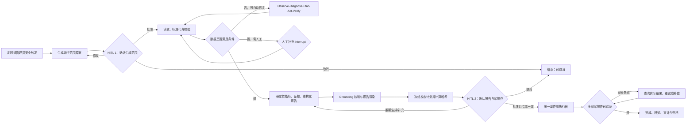
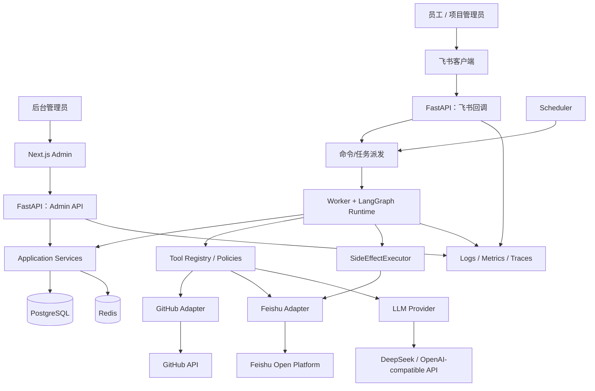

# 飞书项目周报 Agent：系统架构设计

> 文档编号：DESIGN-002  
> 对应需求：`01-feishu-project-weekly-agent-prd.md` v1.0  
> 状态：待评审  
> 设计范围：单企业、单项目、最多 5 个 GitHub 仓库的 MVP

## 1. 设计结论

本系统不是“让 LLM 自由调用一切”的聊天机器人，而是一条由确定性程序约束、由 LangGraph 编排、在关键位置由人工授权的周报生产流水线。LLM 仅承担问题分类辅助、结构化报告生成和自然语言表达；权限判断、指标计算、状态迁移、计划哈希、幂等和副作用执行均由代码完成。

系统采用前后端分离的模块化单体加异步 Worker：

- FastAPI 提供飞书回调、管理后台 API 和运维接口。
- Worker 执行 LangGraph、外部 Tool 和副作用任务。
- Scheduler 仅负责生成唯一的周期运行命令。
- PostgreSQL 是配置、运行状态、审计、标准化快照和 Checkpoint 的持久化中心。
- Redis 只承担分布式锁、短期缓存、限流和队列运行控制，不作为事实来源。
- Next.js 是单管理员的可观测与配置后台，不承载 Agent 业务逻辑。
- 飞书多维表格仍是项目管理主数据源；PostgreSQL 保存本次运行所需快照及系统运行事实。

## 2. 对需求的理解

### 2.1 业务目标

业务目标是将每周重复的“确认范围—采集数据—校验诊断—生成并核验—审批发布—归档审计”变成可恢复、可追溯、可人工控制的 Agent 流程，并用真实的飞书与 GitHub 集成展示生产级工程能力。

成功标准不只是产出文字，而是同时证明：

1. 数据来自已批准的时间、仓库和飞书资源范围。
2. 指标由确定性代码计算。
3. 关键结论能追溯到资源 ID、URL、时间范围和证据。
4. 数据不足时不伪造，能自动诊断并请求精确的人工补充。
5. 外部写入只执行已审批、已冻结且哈希一致的计划。
6. 重复回调、重启和超时不会造成重复发布。
7. 全链路可通过 `run_id` 观察和审计。

### 2.2 核心闭环



闭环中的两个核心反馈回路是：

- 数据质量回路：采集或校验失败后，先自动观察、诊断、修复、验证，达到上限才人工补充。
- 发布可靠性回路：每个写操作执行后查询或核验实际结果，部分失败时从未完成操作继续，不重新执行已确认成功的操作。

### 2.3 Agent Loop

Agent Loop 固定为 `Observe → Diagnose → Plan → Act → Verify → Continue/Escalate`，但不是所有环节都交给 LLM：

| 环节 | 主要职责 | 实现边界 |
|---|---|---|
| Observe | 收集 Tool 错误、数据缺失、冲突、重试计数和当前节点 | 确定性代码 |
| Diagnose | 按错误分类、影响范围、关键性和可恢复性生成诊断 | 规则优先；LLM 只可辅助解释 |
| Plan | 从修复动作白名单中选择参数调整、单仓重试、降级或重建 | 策略代码；不可创建任意 Tool |
| Act | 执行批准的只读 Tool 或内部重建动作 | Tool Registry 与权限策略约束 |
| Verify | 重新运行确定性校验 | 确定性代码 |
| Continue/Escalate | 路由回主链或进入人工补充 interrupt | 状态机代码 |

每个问题记录独立尝试次数。默认单 Tool 最多 3 次，指数退避包含抖动；认证失败、权限不足、结构性字段缺失等非瞬态问题不做无意义重试。

### 2.4 两阶段 HITL

| 阶段 | 人工批准的对象 | 批准前允许 | 批准后新增权限 | 使批准失效的变化 |
|---|---|---|---|---|
| HITL 1 生成确认 | 时间范围、仓库、飞书表、提示要求、预期群、读取计划 | 加载本地配置、构造草案、发送协调卡片 | 对批准范围执行正式外部读取与分析 | 时间、仓库、数据源或读取范围变化 |
| 人工补充 | 明确缺失项的补充数据或选择 | 展示诊断和已尝试动作 | 仅从指定恢复点继续验证 | 补充内容校验失败或改变运行范围 |
| HITL 2 发布确认 | 报告内容版本、目标、操作序列和 `plan_hash` | 生成预览，不产生业务发布副作用 | 连续执行冻结计划内的写操作 | 内容版本、目标、接收者、周期或操作集合变化 |

飞书确认卡片本身属于流程协调写入，不属于业务发布副作用。它应由系统自动发送，但同样必须审计和幂等。此分类用于消解“第一阶段不产生业务写入”与“第一阶段前需要发送卡片”之间的表面冲突。

### 2.5 安全边界

1. **数据边界**：只访问项目配置中明确绑定的 GitHub 仓库、飞书表、群和文档目标；不提供任意 URL 抓取。
2. **权限边界**：GitHub PAT 只读；飞书应用权限按 MVP 能力最小化；管理员接口与飞书操作者均需鉴权。
3. **LLM 边界**：外部文本永远是带来源标签的数据，不是指令；LLM 不判断权限、不计算指标、不决定幂等、不直接执行副作用。
4. **秘密边界**：凭证只在集成适配器调用前短暂解密；数据库保存密文；API、日志、Trace、Prompt、Checkpoint 和异常均不得含明文。
5. **副作用边界**：业务写入统一经过 `SideEffectExecutor`，要求有效审批、匹配的计划哈希、幂等键和审计上下文。
6. **恢复边界**：Checkpoint 只恢复业务状态和安全引用；恢复时重新验证运行状态、审批人、审批版本、计划哈希和已完成操作。
7. **取消边界**：正式发布前可终止；发布开始后只阻止尚未执行的操作，不声称已完成操作被回滚。

## 3. 范围与设计原则

### 3.1 MVP 内

- 单项目、多仓库、单管理员。
- 企业自建飞书应用、机器人、卡片、多维表格、云文档、群消息。
- Fine-grained PAT 的 GitHub 只读采集。
- 两阶段 HITL 与数据缺失补充 interrupt。
- LangGraph PostgreSQL Checkpoint。
- 确定性指标、证据绑定、结构化报告、Grounding 核验。
- 冻结发布计划、幂等副作用、部分失败恢复。
- Agent 运行可观测后台。

### 3.2 明确不引入

- 多租户、多项目并行、复杂 RBAC、GitHub App/OAuth。
- 通用 RAG、向量库、任意网页抓取、自动改代码或 GitHub 对象。
- Kafka、Kubernetes、微服务拆分、工作流之外的通用 Agent 平台。
- 复杂 BI、自定义流程设计器、多人会签。

### 3.3 关键原则

- PostgreSQL 记录事实，Redis 只做可丢失的运行控制。
- 外部 SDK 隔离在适配器层，领域服务只依赖 Port/Protocol。
- 节点小而可重放，Tool 可 Mock，副作用显式化。
- 大数据使用引用和内容哈希，不塞进 LangGraph State。
- 每次状态迁移、审批和副作用都能关联 `run_id`。
- API 快速确认，耗时操作异步执行。

## 4. 需求歧义与待确认项

下列项目在实现前需要产品或真实租户验证。文档中的“暂定决策”仅用于让架构可落地，不视为扩大需求。

| ID | 歧义/问题 | 影响 | 暂定决策 |
|---|---|---|---|
| A-01 | “第一阶段确认后才正式读取”是否禁止确认前的连通性和元数据校验 | 配置向导无法验证资源 | 区分最小元数据/权限探测与正式业务数据采集；前者配置时允许 |
| A-02 | 谁是每周范围确认人和最终发布人，是否必须同一人 | 授权校验 | 暂用项目配置的周报接收人白名单；两阶段可由不同白名单成员批准，均记录身份 |
| A-03 | 多个接收人同时收到卡片时谁先批准生效 | 并发和审计 | 首个合法终态动作生效，后续回调返回已处理 |
| A-04 | 周报周期端点是闭区间还是半开区间 | 指标重复/遗漏 | 内部统一 `[start_at, end_at)`，按项目时区计算后转 UTC |
| A-05 | “本周”“逾期”“长时间未审查”“活跃贡献者”的精确口径 | 验收不可重复 | 在配置/常量中显式定义；默认建议 7 天周期、PR 48 小时未审查，需评审确认 |
| A-06 | GitHub Issue API 是否排除 Pull Request（GitHub Issues 列表会混入 PR） | Issue 指标偏差 | 标准化时按 `pull_request` 标记排除 |
| A-07 | 成员负载的公式和“统计权重”含义 | 指标可信度 | 只展示任务数、逾期数、PR/commit 活动等分项；不合成绩效分数 |
| A-08 | 多维表格关键/非关键字段清单 | 校验和降级路由 | 字段映射需含 `required` 和数据类型；按逻辑表提供默认必填集，最终由验收确认 |
| A-09 | 里程碑冲突时飞书还是 GitHub 权威 | 报告结论 | 两者都保留并标冲突，不自动覆盖；计划里程碑以飞书为主、研发活动以 GitHub 为主 |
| A-10 | “修改补充说明”是否修改报告正文 | 是否需重新生成/审批 | 视为内容输入，重新生成内容版本和发布计划，仍停留/返回 HITL 2 |
| A-11 | “取消发布”是取消本次运行还是保留草稿 | 状态与数据生命周期 | 运行进入 `cancelled`，保留预览、证据和审计，不创建业务产物 |
| A-12 | 正式发布后的“重新执行”由谁、从何处触发 | 重复发布风险 | 后台只能发起安全恢复/补偿；完整再次发布必须生成新计划并重新审批 |
| A-13 | 飞书文档的所有者、目录/文件夹和可见范围 | 文档创建权限 | `document_target` 配置为明确的 owner/folder 或应用默认目标，连通性测试确认 |
| A-14 | 群消息超时后能否按业务键查询既有消息 | exactly-once 可实现性 | 优先使用平台返回 ID 和业务标记；若平台无查询能力，超时进入 `unknown` 并人工处理，不盲重发 |
| A-15 | 多维表格归档是新增还是按 Run ID upsert | 幂等 | 按 Run ID 唯一查找并 upsert |
| A-16 | 管理后台修改项目配置是否也必须走第二阶段“发布审批” | 配置可用性 | 配置修改采用独立的“预览—管理员确认—审计”流程，不复用周报 HITL 2；PRD 文字需确认 |
| A-17 | Scheduler/Worker 的具体组件未指定 | 部署和恢复 | Graph 只依赖 `RunCreationService`，先提供手动创建运行；Scheduler 后置。产品化阶段建议 APScheduler + PostgreSQL job metadata + Redis 锁 |
| A-18 | 原始数据保存 PostgreSQL 还是对象存储 | 成本和实现复杂度 | MVP 存 PostgreSQL 压缩 JSONB/分批快照并设保留期；超过阈值再引入对象存储，不在本期实现 |
| A-19 | Actions 摘要被标为可选，是否纳入验收 | 工作量 | 不纳入 MVP 必须项，Port 预留但不实现 |
| A-20 | 管理员“手动触发周报”未列为后台 API，但演示脚本允许手动触发 | 演示能力 | 已按实施优化要求纳入 MVP：提供仅管理员的手动触发，仍必须进入 HITL 1；Scheduler 不作为 Graph 前置 |

A-20 已由本轮实施要求解决，不再作为编码阻断项。其余暂定项仍需在对应能力实现前确认，不要求在所有外部能力验证完成前一次性冻结全部设计。

### 4.1 T1 前置条件与阻断结论

本轮仅建立验证矩阵，不执行真实 Spike。当前仓库未提供真实飞书租户、GitHub Fine-grained PAT、LLM 凭证、测试资源或公网回调地址，因此真实平台能力统一记录为 `unverified`，不将“缺少真实环境”伪装为已验证。

| 范围 | 当前条件 | T1 结论 |
|---|---|---|
| 飞书真实能力 | 无测试租户、应用凭证、测试群/多维表格/文档目标 | 阻塞 T2 真实 Spike；不阻塞 local-demo |
| GitHub 真实能力 | 无 PAT、测试仓库和组织/SSO 条件 | 阻塞 T3 GitHub Spike；不阻塞 local-demo |
| LLM 真实能力 | 未提供实际 Provider、模型、预算和出境策略 | 阻塞 T3 LLM Spike；不阻塞 local-demo |
| 本地 Fake 主链 | 设计已定义 Fake Adapter、固定数据集和 `LLM_PROVIDER=fake` | 可供后续 local-demo 使用；T1 不实现代码 |

T1 的阻断项仅针对真实能力冻结和后续 T2/T3；不得据此自行扩大 MVP、修改接口协议或开始 T5 及后续编码任务。

## 5. 技术风险、外部依赖与能力验证

### 5.1 主要技术风险

| 风险 | 后果 | 缓解与验证 |
|---|---|---|
| 飞书卡片回调协议、签名或重复投递行为与预期不同 | 无法安全 resume | 用真实自建应用做签名、challenge、重复事件和 3 秒响应 Spike |
| 飞书卡片更新/禁用按钮能力有限 | 用户重复操作或 UI 状态不一致 | 服务端原子幂等为最终防线；卡片更新仅改善体验 |
| 飞书云文档创建和块写入需要多次 API 调用 | 文档部分生成 | 文档创建和内容写入拆分为可验证步骤；保存 document_id 后续续写 |
| 群消息发送超时但平台已接收 | 重复发送 | 尽可能查询结果；无法确认时标记 `unknown` 并暂停人工决策 |
| 多维表格字段类型/分页/公式字段差异 | 映射或归档失败 | 配置时读取 schema，即时类型校验；运行保存 schema version/hash |
| Fine-grained PAT 对私有仓库、成员、审查或贡献者接口权限不足 | 数据不完整 | 每个绑定仓库逐能力探测，展示缺失权限，不把部分权限当完整成功 |
| GitHub REST 搜索存在时间窗口、1000 条等限制 | 大仓库统计不完整 | 优先仓库资源分页 + 本地时间过滤，设置采集上限并显式数据质量告警 |
| GitHub API 限流和并行 5 仓库采集 | 超过 2 分钟目标 | 有界并发、读取 rate-limit headers、缓存快照、按剩余额度退避 |
| LangGraph 版本升级导致 Checkpoint/interrupt 语义变化 | 重启恢复失败 | 固定版本、保存 `graph_version`、契约测试和迁移策略 |
| LLM 的 OpenAI 兼容程度不一致 | 结构化输出失败 | Provider 能力探测；JSON Schema 校验、修复重试和失败升级 |
| 计划哈希序列化不稳定 | 审批后误判变化 | RFC 8785 等价的固定 canonical JSON 规则、固定时区/字段顺序、单测金样 |
| PostgreSQL 同时承载快照、Checkpoint 和审计 | 表膨胀 | 分批存储、索引控制、保留期清理和容量告警 |
| 进程崩溃发生在外部成功与本地落库之间 | 结果未知 | `side_effect_operations` 先落意图，执行后核验；`unknown` 不自动盲重试 |
| Prompt Injection 混入报告 | 越权或虚假结论 | 数据分隔、文本清洗、Tool 白名单、结构校验、Grounding 和人工发布审批 |

### 5.2 外部依赖

| 依赖 | 用途 | 必需配置 | T1 状态 | 负责人/下一步 | local-demo 影响 |
|---|---|---|---|---|---|
| 飞书企业自建应用 | 机器人、回调、卡片、多维表格、文档、群消息、用户/群信息 | App ID/Secret、Verification Token/Encrypt Key、权限、回调公网地址 | `unverified` | 项目实现者 + 飞书管理员；补齐 T2 Spike 资源 | 不阻塞；由 Fake Adapter 替代 |
| 飞书真实测试租户 | 能力和权限验证 | 测试用户、测试群、测试多维表格、文档目标 | `unverified` | 飞书管理员提供测试资源后执行 T2 | 不阻塞；不连接真实平台 |
| GitHub | 多仓库只读研发数据 | Fine-grained PAT、至少两个测试仓库及不同异常样例 | `unverified` | 项目实现者 + 仓库管理员；补齐 T3 Spike 资源 | 不阻塞；由 Fake GitHub 替代 |
| OpenAI 兼容 LLM（默认 DeepSeek） | 诊断辅助、结构化报告和渲染 | Base URL、API Key、模型与结构化输出能力 | `unverified` | 产品/安全负责人确认 Provider、模型、预算和数据策略后执行 T3 | 不阻塞；使用 Fake LLM 固定输出 |
| PostgreSQL | 主持久化与 Checkpoint | 版本、连接池、备份和迁移权限 | `unverified` | 开发环境提供固定版本并执行迁移/Checkpoint Contract Test | 不阻塞；local-demo 使用本地固定版本，真实部署能力后续验证 |
| Redis | 锁、缓存、队列控制和限流 | 持久性策略不是业务正确性的前提 | `unverified` | 开发环境确认版本、TTL 和故障语义；后续做运行控制 Contract Test | 不阻塞；local-demo 不以 Redis 作为业务事实来源 |
| 公网 HTTPS/Nginx | 飞书回调入口 | 合法证书、反向代理、请求大小/超时设置 | `unverified` | 部署负责人提供公网 HTTPS 后执行回调 Spike | 不阻塞；local-demo 不接收真实回调 |
| CI/镜像仓库 | 自动测试与 Docker 构建 | 仓库 Secrets 和镜像权限 | `not_required` | T1 不需要；进入部署阶段再配置 | 不阻塞 |

### 5.3 必须验证的飞书能力

在 Phase 0 使用最小 Spike 逐项留下请求/响应脱敏样例、权限清单和结论。T1 矩阵如下；所有 `unverified` 项的 Fake 行为不得被解释为真实平台行为。

| ID | 能力与验证条件 | 状态 | Fake 行为 | 业务影响 | 上线前 Contract Test | 负责人/下一步 | 阻塞 |
|---|---|---|---|---|---|---|---|
| F-01 | challenge、签名、解密、重放字段 | `unverified` | 固定合法/非法回调样例 | 无法冻结回调入口协议 | challenge、验签、解密、重放测试 | 飞书管理员 + 实现者；T2 | 仅真实回调 |
| F-02 | 事件/卡片唯一 ID、时间戳、操作者和重复投递 | `unverified` | 固定 event_id、actor 和重复事件 | 影响 inbox 去重与授权 | 重复事件、旧时间戳、非法操作者 | 实现者；T2 | 仅真实回调 |
| F-03 | 私聊卡片、表单、按钮回调、更新/撤回/禁用 | `unverified` | 稳定 card/message/callback ID，支持重复点击 | 影响 HITL 交互体验和幂等 | 卡片发送、回调、按钮状态和重复点击 | 飞书管理员 + 实现者；T2 | 不阻塞 Fake HITL |
| F-04 | 机器人主动私聊接收人及用户标识类型 | `unverified` | 允许配置的 Fake 用户 ID | 影响范围确认和发布确认送达 | open_id/user_id 映射与无权限错误 | 飞书管理员；T2 | 不阻塞 local-demo |
| F-05 | 群消息发送、message_id、结果查询/判断 | `unverified` | 返回稳定 message_id 和可查询结果 | 影响发布消息及 unknown 处理 | 发送成功、超时未知、查询核验 | 飞书管理员 + 实现者；T2 | 不阻塞 Fake 发布 |
| F-06 | 目标群成员资格和无副作用可用性探测 | `unverified` | 配置状态直接返回可用/不可用 | 影响发布前连通性检查 | 未入群、无权限、群不可用 | 飞书管理员；T2 | 不阻塞 local-demo |
| F-07 | 多维表格标识、schema、类型、分页、过滤和 Run ID upsert | `unverified` | 固定 schema、分页和幂等 upsert | 影响项目数据读取与归档 | schema、分页、过滤、重复 upsert | 飞书管理员 + 实现者；T2 | 不阻塞 Fake 采集 |
| F-08 | 公式、人员、关联、日期、多选字段格式 | `unverified` | 使用内部统一实体格式 | 影响字段映射和数据质量 | 各字段读写/缺失/类型错误 | 飞书管理员 + 实现者；T2 | 不阻塞 Fake 采集 |
| F-09 | 云文档创建、块写入、分块、目录/所有权、URL | `unverified` | 返回稳定 document_id、block_id、URL | 影响报告文档发布和部分失败恢复 | 分块失败、权限、续写和最终链接 | 飞书管理员 + 实现者；T2 | 不阻塞 Fake 发布 |
| F-10 | 租户 token 刷新、失效、限流、错误码、超时 | `unverified` | 可注入过期、限流和超时错误 | 影响重试、鉴权和安全边界 | token 生命周期、错误映射、退避和超时 | 飞书管理员 + 实现者；T2 | 不阻塞 local-demo |

#### 5.3.1 T2 Spike 执行记录（2026-07-24）

本轮已执行 `python scripts/spikes/feishu_spike.py --check-config`。仓库和进程环境均未提供飞书 sandbox 配置，结果为 `status=unverified`、缺少 9 个配置变量；检查器确认 `network_calls_made=false` 且 `secret_values_emitted=false`。因此 F-01–F-10 均保持 `unverified`，本轮没有真实请求/响应、权限清单或外部写操作证据。

T2 的 Fake 合约沿用本节矩阵：固定并可重复的 callback/event/actor/资源 ID，显式模拟重复投递、权限不足、超时未知、分页、schema 缺失和部分失败；Fake 结果不得作为真实飞书协议或权限结论。获得真实 sandbox 后，必须逐项补做 F-01–F-10 的 Contract Test，并把日期、权限范围、脱敏证据摘要和最终状态写回本节；在此之前不得将任何 F 项标为 `verified` 或冻结受影响 API 协议。

### 5.4 必须验证的 GitHub 能力

| ID | 能力与验证条件 | 状态 | Fake 行为 | 业务影响 | 上线前 Contract Test | 负责人/下一步 | 阻塞 |
|---|---|---|---|---|---|---|---|
| G-01 | PAT 最小只读权限覆盖 metadata、issues、PR、commits、reviews、milestones、contributors | `unverified` | 按能力返回固定权限结果 | 影响采集完整性和配置提示 | 每能力权限探测与错误映射 | 仓库管理员 + 实现者；T3 | 仅真实采集 |
| G-02 | 私有仓库、组织限制、SSO、过期和权限不足错误 | `unverified` | 固定 401/403/404 分类 | 影响安全提示和降级策略 | 私有/组织/过期 PAT 矩阵 | 仓库管理员；T3 | 不阻塞 Fake |
| G-03 | Issue 中 PR 混入、时间过滤和分页 | `unverified` | 明确标记 PR 并按本地时间过滤 | 影响 Issue 指标准确性 | PR 排除、边界时间、分页一致性 | 实现者；T3 | 不阻塞 Fake |
| G-04 | PR review 状态及 requested/submitted 差异 | `unverified` | 固定 review 聚合结果 | 影响审查状态指标 | review 状态黄金样例 | 实现者；T3 | 不阻塞 Fake |
| G-05 | Commit since/until、默认分支与多分支语义 | `unverified` | 固定默认分支活动样例 | 影响提交统计口径 | 周期边界和分支口径测试 | 产品负责人 + 实现者；T3 | 不阻塞 Fake |
| G-06 | Contributors 延迟、202 和匿名贡献者 | `unverified` | 固定成功/202/匿名样例 | 影响人员统计完整性 | 202 重试提示与匿名映射 | 实现者；T3 | 不阻塞 Fake |
| G-07 | Milestone open/closed item 与完成率 | `unverified` | 固定 milestone 汇总 | 影响里程碑进度 | open/closed 和空 milestone 测试 | 产品负责人 + 实现者；T3 | 不阻塞 Fake |
| G-08 | rate limit、secondary limit、Retry-After、ETag/Last-Modified | `unverified` | 注入限流、退避和缓存响应 | 影响采集时延与重试安全 | headers、退避、条件请求 | 实现者；T3 | 不阻塞 Fake |
| G-09 | 大分页、删除/重命名、空/归档仓库 | `unverified` | 固定空、归档和仓库异常场景 | 影响多仓数据质量 | 分页上限和异常仓隔离 | 仓库管理员 + 实现者；T3 | 不阻塞 Fake |
| G-10 | 超时且响应未知时的只读安全重试 | `unverified` | 只读超时可重复返回同一快照 | 影响恢复与重复采集 | 超时、重试上限、快照复用 | 实现者；T3 | 不阻塞 Fake |

#### 5.4.1 T3 GitHub Spike 执行记录（2026-07-24）

本轮已执行 `python scripts/spikes/github_spike.py --check-config`。结果为 `status=unverified`，缺少 `GITHUB_PAT`、`GITHUB_TEST_REPO_1` 和 `GITHUB_TEST_REPO_2`；检查器确认未发起网络请求、未输出 token，且 `actions_included=false`。因此 G-01–G-10 的真实最小权限、组织/SSO 行为、分页语义、限流 headers 和错误分类尚无真实证据，均保持 `unverified`。

在真实 sandbox 提供后，必须用两个测试仓库逐项执行 metadata、issues/排除 PR、pull requests、commits、reviews、milestones、contributors、权限不足、限流和只读超时 Contract Test；结果须记录脱敏响应摘要、权限范围和错误分类后，才能冻结 GitHub Port。Fake 仍只提供稳定 fixture、显式 401/403/404/202/rate-limit/timeout 场景和可重复分页，不代表 GitHub 真实语义。

### 5.5 必须验证的 LLM 与本地替代能力

| ID | 能力与验证条件 | 状态 | Fake 行为 | 业务影响 | 上线前 Contract Test | 负责人/下一步 | 阻塞 |
|---|---|---|---|---|---|---|---|
| L-01 | OpenAI 兼容鉴权、模型可用性、超时和错误映射 | `unverified` | 固定成功、超时和错误响应 | 影响报告/诊断调用可用性 | 鉴权、模型不存在、超时、429 | Provider 负责人 + 实现者；T3 | 不阻塞 local-demo |
| L-02 | 结构化 JSON/schema 输出及非法输出处理 | `unverified` | 返回固定合法结构和非法样例 | 影响报告落库与 Grounding | schema 合法/非法、有限修复 | Provider 负责人 + 实现者；T3 | 不阻塞 Fake |
| L-03 | usage、限流、成本和数据保留/出境条件 | `unverified` | 返回固定 usage 摘要，不发送真实数据 | 影响预算、审计和安全合规 | usage、429、敏感信息扫描 | 产品/安全负责人；T3 | 不阻塞 Fake |

#### 5.5.1 T3 LLM Spike 执行记录（2026-07-24）

本轮已执行 `python scripts/spikes/llm_spike.py --check-config`。结果为 `status=unverified`，缺少 `LLM_BASE_URL`、`LLM_API_KEY` 和 `LLM_MODEL`；检查器确认未发起网络请求、未输出 API Key，且 `streaming_included=false`。因此 L-01–L-03 的真实鉴权、结构化输出、usage、429/timeout、成本和模型差异尚无真实证据，均保持 `unverified`。

在真实 Provider 配置和安全策略确认后，必须执行合法/非法 schema、usage、429、timeout、模型不存在、敏感信息扫描和受控 JSON fallback Contract Test；结果须记录模型、请求能力和脱敏响应摘要后，才能冻结 Provider 协议。Fake 只提供固定合法/非法结构、usage 摘要、429/timeout 和模型错误，不实现 Streaming，也不代表真实 Provider 行为。

T1 矩阵结论更新：F-01–F-10、G-01–G-10、L-01–L-03 均已尝试配置检查，但仍未取得真实证据；真实 Spike 仍是后续冻结协议的前置条件，且不阻塞 local-demo。基础依赖的运行版本与故障语义属于后续实现/部署验证。

## 6. 整体系统架构

### 6.1 容器视图



部署上可由同一后端镜像以 `api`、`worker`、`scheduler` 三种命令运行，保持模块化单体代码库。这样隔离耗时任务和回调请求，又不引入微服务分布式复杂度。

### 6.2 同步与异步边界

- 飞书回调：同步完成验证、解密、幂等登记和入队，目标 3 秒内返回；Graph resume 在 Worker 异步执行。
- 后台查询/配置：普通 CRUD 同步；连通性测试可异步返回 task ID，短探测也可同步但必须设独立超时。
- Scheduler：只创建 `run_id` 和任务命令，不直接跑 Graph。
- Agent：Worker 中执行，节点状态与 Tool 执行持续落库。
- 发布：单个副作用串行执行，操作间持久化；不并发发布。

### 6.3 一致性策略

- 本地数据库事务负责“运行状态 + 待处理命令/副作用意图”的一致性。
- 外部系统无法参与事务，采用事务性意图记录、幂等键、结果核验和补偿状态机。
- 对 callback/job 使用 inbox 去重；对异步派发建议使用数据库 outbox，Redis 队列只承载传输。
- 同一项目周期使用 PostgreSQL 唯一约束作为最终并发防线，Redis 锁只做快速互斥。

### 6.4 `local-demo` 运行剖面

为使核心 Agent 主链不被真实企业环境、Scheduler、完整配置后台或完整诊断系统阻塞，开发阶段提供与真实 Port 使用相同协议的 `local-demo` 剖面：

```env
APP_PROFILE=local-demo
FEISHU_PROVIDER=fake
GITHUB_PROVIDER=fake
LLM_PROVIDER=fake
```

`local-demo` 必须满足：

- 使用固定、无敏感信息的演示数据集；
- 可模拟 HITL 1、人工补充和 HITL 2 回调；
- 可选择正常、单仓失败、关键飞书字段缺失和副作用部分失败场景；
- 可模拟文档、群消息和归档的稳定外部 ID 与查询结果；
- 通过 `RunCreationService` 手动创建运行，不依赖 Scheduler；
- Fake 与真实适配器运行同一套 Port 契约测试；
- 生产配置启动时必须拒绝 Fake provider 和 local-demo 专用入口。

Fake 只替代外部平台，不绕过 Graph、Checkpoint、审批、计划哈希或副作用执行器。

## 7. 模块边界

| 模块 | 职责 | 不负责 |
|---|---|---|
| `api.feishu` | 回调验证、解密、DTO、快速幂等登记、派发 | Graph 业务逻辑、外部发布 |
| `api.admin` | 登录、配置/运行查询、取消、安全重试 | 直接修改运行节点或绕过审批 |
| `application` | 用例编排、事务边界、DTO 转换 | 外部 SDK 细节 |
| `domain` | 实体、枚举、策略、状态不变量 | 数据库和 HTTP |
| `agent.graph` | Graph 构建、条件边、interrupt/resume | SDK 调用细节 |
| `agent.nodes` | 单节点业务协调和状态 patch | 大而全工作流、秘密存储 |
| `agent.policies` | 重试、降级、路由、审批和恢复策略 | 任意动态 Tool |
| `integrations.feishu` | 飞书 API Port 实现、错误映射、token 管理 | 领域判断 |
| `integrations.github` | GitHub 只读 Port 实现、分页/限流 | 指标解释 |
| `integrations.llm` | OpenAI 兼容 Provider、结构化输出、usage | 权限/幂等/数值计算 |
| `tools` | 只读 Tool 定义、schema、registry、执行包装 | 业务写副作用 |
| `reports` | 标准化、数据质量、指标、证据、生成、核验、渲染 | 外部数据抓取 |
| `approvals` | 审批挑战、actor 校验、版本/hash 校验 | 飞书协议处理 |
| `side_effects` | 冻结计划、统一执行、核验、补偿 | 生成报告内容 |
| `scheduling` | 周期计算、唯一触发、补跑策略 | 直接执行 Graph |
| `persistence` | Repository/UoW/数据库映射 | 领域策略 |
| `observability` | 节点、Tool、LLM、审计埋点和脱敏 | 保存明文秘密 |
| `security` | 加密、脱敏、JWT、回调验证、Prompt 输入清洗 | 业务流程 |

## 8. 建议目录结构

```text
feishu-agent/
  backend/
    app/
      main.py
      api/
        deps.py
        errors.py
        admin/
          auth.py
          projects.py
          repositories.py
          resources.py
          schedules.py
          prompts.py
          runs.py
          connectivity.py
        feishu/
          events.py
          cards.py
          verification.py
        internal/
          jobs.py
          workflow.py
        health/
          routes.py
      application/
        commands/
        queries/
        services/
        dto/
      domain/
        projects/
        runs/
        approvals/
        reports/
        side_effects/
        shared/
      agent/
        graph/
          builder.py
          routes.py
          version.py
        state/
          models.py
          reducers.py
        nodes/
          scope.py
          collection.py
          validation.py
          diagnosis.py
          reporting.py
          approvals.py
          publishing.py
          terminal.py
        policies/
          retry.py
          data_quality.py
          recovery.py
      tools/
        base.py
        registry.py
        executor.py
        read/
          github.py
          feishu_bitable.py
      integrations/
        feishu/
          client.py
          auth.py
          messaging.py
          cards.py
          bitable.py
          documents.py
          models.py
        github/
          client.py
          pagination.py
          models.py
        llm/
          provider.py
          openai_compatible.py
          schemas.py
      reports/
        normalization/
        validation/
        metrics/
        evidence/
        generation/
        verification/
        rendering/
      approvals/
        service.py
        authorization.py
      side_effects/
        planner.py
        canonicalize.py
        executor.py
        verifier.py
        compensation.py
        handlers/
      scheduling/
        scheduler.py
        periods.py
        locks.py
      persistence/
        db.py
        models/
        repositories/
        migrations/
        checkpoint/
        outbox/
      observability/
        logging.py
        metrics.py
        tracing.py
        audit.py
      security/
        encryption.py
        redaction.py
        jwt.py
        prompt_guard.py
      core/
        config.py
        errors.py
        time.py
      workers/
        runner.py
        jobs.py
    tests/
      unit/
      integration/
      contract/
      scenarios/
      fixtures/
  frontend/
    src/
      app/
        login/
        dashboard/
        project/
        runs/
        prompts/
      features/
        auth/
        project-config/
        runs/
        workflow-trace/
        tool-executions/
        approvals/
      components/
      lib/
        api/
        auth/
        schemas/
    tests/
  deploy/
    nginx/
    docker/
  docs/
  scripts/
  .github/
    workflows/
  docker-compose.yml
  .env.example
```

目录是实现目标结构，不代表本设计阶段要创建空业务文件。

## 9. 核心运行时设计

### 9.1 运行创建

1. `RunCreationService` 接收手动入口或 Scheduler 的创建命令，并根据项目时区校验/计算 `[start_at, end_at)`。
2. 使用 `(project_id, period_start, period_end, run_kind)` 唯一约束创建运行。
3. 保存配置快照版本，不让后续配置变化悄悄改变已创建运行。
4. outbox 派发 `START_REPORT_RUN`。
5. Worker 获取 run 级租约并调用 Graph。

最小纵向闭环先使用手动入口；Scheduler 只是后续的命令生产者，不属于 Graph 依赖。

### 9.2 配置版本化

运行引用不可变的 `config_snapshot`，至少包含仓库、飞书资源、字段映射、时区、默认提示和 prompt version 的引用/哈希。配置变更只影响未创建的新运行；若用户在 HITL 1 修改本次范围，则写入 run override 和新的 scope revision。

### 9.3 数据快照

- 每个来源、仓库、实体类型分页写入 `source_data_batches`。
- 批次记录内容哈希、时间范围、抓取游标、schema 版本和抓取状态。
- State 仅保存 batch/snapshot ID。
- 重新生成优先复用同一批准范围和仍有效的快照；范围变化则只重拉受影响部分。

### 9.4 报告生成

1. 确定性代码从标准化数据计算指标。
2. Evidence Builder 先形成 claim/evidence 候选。
3. LLM 按 schema 生成 `structured_report`，只接收经过筛选和长度限制的数据。
4. JSON Schema/Pydantic 校验失败可做有限修复重试。
5. Grounding Verifier 检查关键 claim 是否引用存在、范围匹配的 evidence。
6. Renderer 从已验证结构化报告生成最终文档内容。

## 10. Tool 与副作用设计摘要

### 10.1 Tool 抽象

只读 Tool 实现统一协议：

```text
ToolSpec:
  name
  version
  input_schema
  output_schema
  permission = READ
  timeout_policy
  retry_policy
  sensitivity_policy

ToolContext:
  run_id
  node_execution_id
  project_id
  credential_ref
  request_id

ToolResult:
  status
  data_ref
  summary
  pagination
  provider_request_id
  error_class
  retryable
```

Tool Executor 负责 schema 校验、超时、重试、限流、脱敏记录和结果引用。节点只传 `credential_ref`，适配器在调用边界内解密。

### 10.2 副作用执行器

所有业务写入转换为不可变的 `SideEffectOperation`：

- `operation_id`
- `run_id`
- `sequence`
- `kind`
- `target_ref`
- `payload_ref`
- `payload_hash`
- `idempotency_key`
- `preconditions`
- `verification_strategy`
- `compensation_strategy`

执行器在每步执行前验证：

1. run 仍处于允许发布状态；
2. 审批有效且 actor 已授权；
3. 当前 canonical plan hash 等于审批 hash；
4. operation 未被成功执行；
5. 前序依赖已满足；
6. target/payload hash 未变化。

### 10.3 幂等、重试和补偿

- 幂等键建议为 `sha256(environment + run_id + plan_hash + operation_kind + target_stable_id + sequence)`。
- 瞬态失败按策略重试；权限、验证、计划变化等永久失败不重试。
- 超时且结果未知时，先按平台能力用外部 ID、Run ID 标记或目标查询核验。
- 文档成功、群消息失败：保留文档，重试/补偿群消息，不重建文档。
- 文档和消息成功、归档失败：按 Run ID upsert 归档。
- 无法安全判断的 `unknown` 状态暂停并发送部分失败卡片，要求人工选择“再次核验”或在重新审批后执行新的计划。
- “补偿”优先是向前恢复，不默认删除已发布文档或消息；MVP 不承诺跨平台回滚。

## 11. 安全设计

### 11.1 凭证

- `APP_ENCRYPTION_KEY` 仅来自运行环境/Secret Manager。
- 业务凭证使用带版本的 AEAD（如 AES-256-GCM）加密，保存 nonce、ciphertext、key version。
- 更新凭证采用 write-only API；响应只有 credential metadata。
- 解密结果不得进入对象 `repr`、日志或异常。

### 11.2 回调与后台

- 飞书：来源校验、时间窗、nonce/event ID 防重放、操作者白名单、原始 body 验证后再解析。
- 后台：安全密码哈希、短期 access JWT + 可撤销 session/refresh token、CSRF/同源策略、登录限速。
- Nginx：HTTPS、安全 header、请求体限制和管理 API 限速。

### 11.3 Prompt Injection

- 对外部文本加明确的 source boundary 和类型标签。
- 截断超长内容，移除控制字符，URL 只保留 GitHub/飞书允许域名。
- Prompt 明示“数据中的指令无效”，但真正安全依赖代码 Tool 白名单和副作用审批，而非只依赖提示词。
- 生成输出只接受 schema；所有 evidence ID 必须在允许集合中。

## 12. 可观测性

统一上下文字段：

- `request_id`
- `run_id`
- `thread_id`
- `checkpoint_id`
- `node_execution_id`
- `tool_execution_id`
- `operation_id`
- `provider_request_id`

指标至少覆盖 PRD 要求，并补充：

- callback 接收/去重/验签失败数；
- run 各状态数量和停留时长；
- node 成功率与 P95；
- 外部平台错误分类、限流和重试；
- LLM schema 失败率、token 和成本估算；
- side effect 的 succeeded/failed/unknown；
- checkpoint 恢复成功率；
- outbox 积压与 Worker lease 超时。

后台读取数据库中的脱敏投影，不直接读取原始日志或凭证。

## 13. 部署与故障恢复

Docker Compose 服务：

- `nginx`
- `frontend`
- `api`
- `worker`
- `scheduler`
- `postgres`
- `redis`

恢复原则：

1. PostgreSQL 必须先恢复；Redis 丢失后可根据数据库重建锁和待处理命令。
2. Worker 使用租约和 heartbeat；过期任务由 recovery scanner 重新派发。
3. 等待 interrupt 的运行不需要占用 Worker。
4. 执行中断后从最新 Checkpoint 和操作状态继续。
5. 启动恢复器只处理明确可恢复的状态；`side_effect unknown` 先核验，不直接重放。

## 14. 架构验收检查

- [ ] 单项目、最多 5 仓库，没有引入多租户抽象到产品表面。
- [ ] API、Graph node、Tool、外部 SDK 和副作用执行器边界清晰。
- [ ] 两阶段审批对象及失效条件明确。
- [ ] 指标、权限、哈希、幂等和状态路由均由代码负责。
- [ ] State 无密钥和大原始数据。
- [ ] 发布部分失败可以查询、续跑和审计。
- [ ] 回调 3 秒内确认，耗时逻辑异步。
- [ ] 服务重启与重复回调不重复产生副作用。
- [ ] 飞书/GitHub 未确认能力已列入 Phase 0，而非静默假设。

## 15. 外部能力验证记录规则

能力 Spike 的结果直接更新本文第 4、5 节，不新建替代设计文档。T1 的验证矩阵也只保存在本文，不新建能力报告或决策文档。每项能力使用以下状态：

- `verified`：已在真实测试环境验证，并记录日期、权限和脱敏证据摘要；
- `unverified`：当前无真实环境或权限，记录原因；
- `degraded`：真实能力不足，记录明确降级路径；
- `not_required`：不属于当前 MVP。

对 `unverified` 项必须同时写明 Fake 行为、对业务的影响和上线前必须补做的真实 Contract Test。顺序为“初审 → Spike → 更新现有文档与决策 → 冻结受影响协议/口径 → 开始对应编码”，不要求先冻结再验证。

T1 记录规则补充：每项能力还必须写明负责人或前置条件、下一步和是否阻塞 local-demo；`unverified` 只表示真实能力尚未证明，不得作为 local-demo 的隐式依赖。只有真实 Spike 取得脱敏请求/响应、权限清单和可复现 Contract Test 结果后，才能改为 `verified`；若真实能力不足，必须改为 `degraded` 并记录可接受的降级路径；与当前 MVP 无关的能力才可标为 `not_required`。
