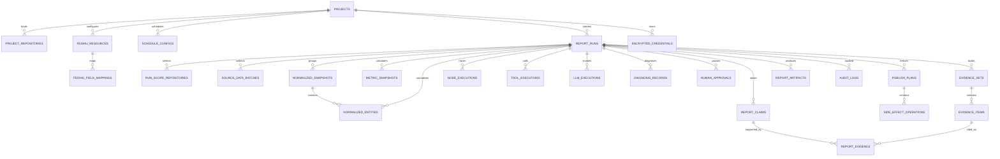

# 飞书项目周报 Agent：数据库设计

> 文档编号：DESIGN-003  
> 对应需求：`01-feishu-project-weekly-agent-prd.md` v1.0  
> 状态：待评审  
> 数据库：PostgreSQL；Redis 仅用于缓存、锁、限流和任务运行控制

## 1. 设计目标

数据库需要同时支撑：

- 单项目配置及其不可变运行快照；
- LangGraph Checkpoint、interrupt 和重启恢复；
- 双数据源的原始批次引用与标准化结果；
- 两阶段审批和人工补充；
- Tool、节点、LLM、诊断和审计可观测性；
- 冻结计划、幂等副作用和部分失败续跑；
- 报告、证据和飞书产物引用；
- 管理后台的 P95 800ms 查询目标。

飞书多维表格是项目管理主数据源；PostgreSQL 是本系统的配置、运行、审计与运行快照事实源。Redis 数据丢失不得破坏业务正确性。

## 2. 通用约定

- 主键默认 `uuid`，由应用生成 UUIDv7（若运行库不支持则 UUID4）。
- 所有时间使用 `timestamptz` 并存 UTC；项目时区另存 IANA 名称。
- 时间区间统一为半开区间 `[period_start, period_end)`。
- 表名、字段名使用 `snake_case`。
- 状态枚举优先使用 PostgreSQL `varchar + CHECK`，便于迁移；应用层使用严格 Enum。
- 可演进结构使用 `jsonb`，但用于筛选、唯一性和关联的数据必须独立成列。
- 乐观并发字段统一为 `version integer not null default 1`。
- 外部资源保存稳定 ID 和 URL，不保存凭证明文。
- 删除优先软停用或保留审计；运行事实不级联物理删除。
- 任何摘要字段在写入前完成敏感信息脱敏。

## 3. 关系概览

LangGraph 自带 Checkpointer 表由所选固定版本的迁移管理；`report_runs.thread_id` 将业务运行映射到 Checkpoint thread。

## 4. 配置与身份表

### 4.1 `projects`

单项目也保留项目实体，以避免配置散落；MVP 用约束/应用策略只允许一条 active 项目。

| 字段 | 类型 | 约束/说明 |
|---|---|---|
| `id` | uuid | PK |
| `code` | varchar(64) | unique，稳定业务标识 |
| `name` | varchar(200) | not null |
| `description` | text | nullable |
| `status` | varchar(24) | `draft/active/paused` |
| `timezone` | varchar(64) | IANA 时区，not null |
| `default_period_rule` | jsonb | 默认统计区间规则 |
| `default_prompt_version_id` | uuid | FK `prompt_versions`，可空至配置完成 |
| `feishu_project_record_id` | varchar(128) | 外部项目表记录 ID |
| `config_revision` | integer | not null，配置确认后递增 |
| `created_by` | varchar(128) | 管理员/飞书用户稳定 ID |
| `created_at` | timestamptz | not null |
| `updated_at` | timestamptz | not null |

索引与约束：

- `uq_projects_code(code)`
- `idx_projects_status(status)`
- 应用事务内/可选 partial unique index 保证最多一个 `status='active'`。

### 4.2 `project_repositories`

| 字段 | 类型 | 约束/说明 |
|---|---|---|
| `id` | uuid | PK |
| `project_id` | uuid | FK，not null |
| `github_repository_id` | bigint | GitHub 稳定 repo ID，配置验证后写入 |
| `owner` | varchar(128) | not null |
| `repo` | varchar(128) | not null |
| `display_name` | varchar(256) | not null |
| `repository_type` | varchar(32) | `frontend/backend/deploy/other` |
| `weight` | numeric(8,4) | 仅保留配置值，MVP 不生成绩效综合分 |
| `enabled` | boolean | default true |
| `default_branch` | varchar(255) | 探测结果 |
| `last_connectivity_status` | varchar(24) | `unknown/ok/degraded/failed` |
| `last_connectivity_at` | timestamptz | nullable |
| `created_at`,`updated_at` | timestamptz | not null |

约束：

- unique `(project_id, owner, repo)`
- unique `(project_id, github_repository_id)` where ID not null
- `weight >= 0`
- 应用层限制 enabled 仓库数量 `1..5`。

### 4.3 `feishu_resources`

| 字段 | 类型 | 约束/说明 |
|---|---|---|
| `id` | uuid | PK |
| `project_id` | uuid | FK |
| `resource_type` | varchar(32) | 见枚举 |
| `resource_key` | varchar(64) | 如 `project_table/default_publish_group` |
| `app_token` | varchar(128) | 多维表格使用，可空 |
| `table_id` | varchar(128) | 多维表格使用，可空 |
| `external_id` | varchar(256) | 群、文件夹或其他稳定 ID |
| `display_name` | varchar(256) | 脱敏可展示名称 |
| `url` | text | 可空 |
| `capabilities` | jsonb | 已验证能力和时间 |
| `schema_hash` | char(64) | 表 schema 哈希，可空 |
| `enabled` | boolean | default true |
| `created_at`,`updated_at` | timestamptz | not null |

`resource_type`：

- `bitable_project`
- `bitable_member`
- `bitable_repository`
- `bitable_task`
- `bitable_milestone`
- `bitable_risk_plan`
- `bitable_report_archive`
- `publish_group`
- `document_target`

约束：unique `(project_id, resource_type, resource_key)`。

### 4.4 `feishu_field_mappings`

不在代码中写死中文列名。

| 字段 | 类型 | 约束/说明 |
|---|---|---|
| `id` | uuid | PK |
| `resource_id` | uuid | FK `feishu_resources` |
| `logical_field` | varchar(128) | 内部字段名 |
| `external_field_id` | varchar(128) | 优先使用飞书字段 ID |
| `external_field_name` | varchar(256) | 仅展示/诊断 |
| `external_field_type` | varchar(64) | 探测到的类型 |
| `converter` | varchar(64) | 白名单转换器 |
| `required_level` | varchar(16) | `critical/required/optional` |
| `mapping_options` | jsonb | 人员/状态/枚举映射 |
| `enabled` | boolean | default true |
| `created_at`,`updated_at` | timestamptz | not null |

约束：unique `(resource_id, logical_field)`，unique `(resource_id, external_field_id)`。

### 4.5 `encrypted_credentials`

| 字段 | 类型 | 约束/说明 |
|---|---|---|
| `id` | uuid | PK |
| `project_id` | uuid | FK，可空用于全局 LLM 配置 |
| `credential_type` | varchar(32) | `github_pat/feishu_app_secret/llm_api_key` |
| `label` | varchar(128) | not null |
| `ciphertext` | bytea | not null |
| `nonce` | bytea | not null |
| `key_version` | varchar(32) | not null |
| `fingerprint` | char(64) | HMAC/不可逆指纹，用于识别更新 |
| `status` | varchar(24) | `active/invalid/expired/revoked` |
| `expires_at` | timestamptz | 可空 |
| `last_validated_at` | timestamptz | 可空 |
| `created_by`,`updated_by` | varchar(128) | not null |
| `created_at`,`updated_at` | timestamptz | not null |

索引：`idx_credentials_project_type(project_id, credential_type, status)`。任何查询 DTO 不包含密文、nonce。

### 4.6 `schedule_configs`

| 字段 | 类型 | 说明 |
|---|---|---|
| `id` | uuid | PK |
| `project_id` | uuid | FK |
| `cron_expression` | varchar(128) | not null |
| `timezone` | varchar(64) | IANA |
| `enabled` | boolean | not null |
| `misfire_policy` | varchar(24) | `skip/fire_once` |
| `next_fire_at` | timestamptz | 可空 |
| `last_fire_at` | timestamptz | 可空 |
| `revision` | integer | 乐观并发 |
| `created_at`,`updated_at` | timestamptz | not null |

MVP 每项目一条：unique `(project_id)`。

### 4.7 `prompt_versions`

| 字段 | 类型 | 说明 |
|---|---|---|
| `id` | uuid | PK |
| `prompt_type` | varchar(32) | `system/report/diagnosis/render` |
| `version` | integer | not null |
| `content` | text | 不得包含密钥 |
| `content_hash` | char(64) | not null |
| `status` | varchar(16) | `draft/active/retired` |
| `model_constraints` | jsonb | 可空 |
| `created_by` | varchar(128) | not null |
| `created_at` | timestamptz | not null |

约束：unique `(prompt_type, version)`；每类最多一个 active（partial unique）。

### 4.8 管理员身份

#### `admin_users`

`id`, `username`（unique）, `password_hash`, `status(active/locked/disabled)`, `failed_login_count`, `locked_until`, `last_login_at`, `created_at`, `updated_at`。

#### `admin_sessions`

`id`, `admin_user_id`, `refresh_token_hash`（unique）, `issued_at`, `expires_at`, `revoked_at`, `ip_hash`, `user_agent_summary`。Access JWT 短期有效，Session 用于撤销和刷新。

### 4.9 `onboarding_sessions`

用于首次飞书配置向导中断、回退和服务重启恢复：

`id`, `feishu_actor_id`, `status(in_progress/pending_confirmation/completed/cancelled/expired)`, `current_step`, `draft_config jsonb`, `credential_ref`, `card_message_id`, `revision`, `expires_at`, `created_at`, `updated_at`。

要求：

- `draft_config` 不含明文 PAT；PAT 首次提交即写入加密凭证暂存记录。
- 同一管理员最多一个活动 session（partial unique）。
- 完成确认后在同一事务内激活项目配置并关闭 session。
- 过期 session 清理前先销毁未采用的暂存凭证密文。

## 5. 运行与状态表

### 5.1 `report_runs`

| 字段 | 类型 | 约束/说明 |
|---|---|---|
| `id` | uuid | PK，即 `run_id` |
| `project_id` | uuid | FK |
| `thread_id` | varchar(128) | unique，LangGraph thread |
| `run_kind` | varchar(16) | `scheduled/manual` |
| `status` | varchar(40) | 见状态枚举 |
| `current_stage` | varchar(40) | 业务阶段 |
| `current_node` | varchar(80) | 可空 |
| `requester_type` | varchar(16) | `scheduler/feishu/admin` |
| `requester_id` | varchar(128) | not null |
| `period_start`,`period_end` | timestamptz | not null |
| `project_timezone` | varchar(64) | not null |
| `scope_revision` | integer | default 1 |
| `config_revision` | integer | 运行创建时快照 |
| `config_snapshot` | jsonb | 无秘密的不可变配置快照 |
| `user_instructions` | text | 清洗、限长 |
| `graph_version` | varchar(32) | not null |
| `data_quality_status` | varchar(16) | `unknown/complete/partial/blocked` |
| `overall_confidence` | numeric(5,4) | 0..1，可空 |
| `has_human_input` | boolean | default false |
| `has_retry` | boolean | default false |
| `has_partial_failure` | boolean | default false |
| `approved_publish_plan_id` | uuid | 可空 |
| `error_code` | varchar(64) | 可空 |
| `error_summary` | text | 脱敏 |
| `active_elapsed_ms` | bigint | 不含人工等待 |
| `wait_elapsed_ms` | bigint | 可空 |
| `started_at`,`completed_at`,`cancelled_at` | timestamptz | 可空 |
| `created_at`,`updated_at` | timestamptz | not null |
| `version` | integer | 乐观并发 |

关键约束/索引：

- check `period_start < period_end`
- unique `(project_id, period_start, period_end, run_kind)` 可按产品决定 manual 是否复用；更严格的活动唯一性由下述 partial index 保障
- partial unique `(project_id, period_start, period_end)` where status in 所有非终态
- `idx_runs_status_created(status, created_at desc)`
- `idx_runs_project_period(project_id, period_start desc)`
- `idx_runs_requester(requester_id, created_at desc)`
- `idx_runs_flags(has_human_input, has_retry, has_partial_failure)`

### 5.2 `run_scope_repositories`

保存 HITL 1 当前 revision 的仓库范围：

`id`, `run_id`, `scope_revision`, `project_repository_id`, `selected`, `created_at`。

unique `(run_id, scope_revision, project_repository_id)`。

### 5.3 `run_status_history`

`id bigserial`, `run_id`, `from_status`, `to_status`, `reason_code`, `actor_type`, `actor_id`, `node_name`, `checkpoint_ref`, `created_at`。

索引 `(run_id, created_at)`；用于精确时间线，不能只依赖当前状态。

### 5.4 `node_executions`

| 字段 | 类型 | 说明 |
|---|---|---|
| `id` | uuid | PK |
| `run_id` | uuid | FK |
| `node_name` | varchar(80) | not null |
| `node_attempt` | integer | not null |
| `checkpoint_before`,`checkpoint_after` | varchar(256) | 可空 |
| `status` | varchar(20) | `running/succeeded/failed/interrupted/skipped` |
| `input_summary`,`output_summary` | jsonb | 脱敏、小体积 |
| `error_class`,`error_summary` | varchar/text | 可空 |
| `started_at`,`ended_at` | timestamptz | |
| `duration_ms` | bigint | |

unique `(run_id, node_name, node_attempt)`；索引 `(run_id, started_at)`。

### 5.5 LangGraph Checkpoint

采用官方 PostgreSQL checkpointer 对应固定 LangGraph 版本的表，不手写其内部 schema。业务要求：

- `thread_id = report_runs.thread_id`
- checkpoint metadata 必须含 `run_id`, `graph_version`, `current_stage`, `state_schema_version`
- State 仅含安全引用
- 迁移时先做旧 Checkpoint 恢复契约测试

若需要后台定位，增加只读映射表 `workflow_checkpoint_refs`：

`id`, `run_id`, `thread_id`, `checkpoint_id`, `node_name`, `interrupt_type`, `created_at`，unique `(thread_id, checkpoint_id)`。

## 6. 数据采集与报告表

### 6.1 `source_data_batches`

保存原始分页快照，MVP 用 PostgreSQL JSONB；超过配置阈值拒绝继续并标记数据质量，不静默无限增长。

| 字段 | 类型 | 说明 |
|---|---|---|
| `id` | uuid | PK |
| `run_id` | uuid | FK |
| `source_type` | varchar(24) | `github/feishu_bitable` |
| `source_resource_id` | uuid | 仓库绑定或飞书资源 FK |
| `entity_type` | varchar(32) | issue/pr/commit/review/... |
| `page_no` | integer | not null |
| `cursor` | varchar(512) | 可空 |
| `period_start`,`period_end` | timestamptz | |
| `payload` | jsonb | 清除秘密后的原始响应必要字段 |
| `payload_hash` | char(64) | not null |
| `record_count` | integer | not null |
| `schema_version` | varchar(32) | not null |
| `fetch_status` | varchar(20) | `complete/partial/failed` |
| `fetched_at` | timestamptz | not null |
| `expires_at` | timestamptz | 生命周期 |

unique `(run_id, source_type, source_resource_id, entity_type, page_no, payload_hash)`；索引 `(run_id, entity_type)`、`(expires_at)`。

### 6.2 `normalized_snapshots`

为同一次标准化输出提供稳定引用：

`id`, `run_id`, `source_batch_set_hash`, `mapping_revision`, `normalizer_version`, `entity_count`, `status(complete/partial/failed)`, `content_hash`, `created_at`。

unique `(run_id, content_hash)`；State 中的 `normalized_snapshot_ref` 指向此表。

### 6.3 `normalized_entities`

统一内部模型，可按实体类型保留通用列和 `attributes`：

`id`, `run_id`, `normalized_snapshot_id`, `source_type`, `entity_type`, `source_resource_id`, `external_id`, `repository_id`, `url`, `title`, `state`, `author_external_id`, `assignee_external_ids jsonb`, `labels jsonb`, `milestone_external_id`, `created_at_external`, `updated_at_external`, `closed_at_external`, `occurred_at`, `raw_batch_id`, `raw_summary`, `attributes jsonb`, `content_hash`, `fetched_at`。

约束 unique `(run_id, source_type, source_resource_id, entity_type, external_id, content_hash)`；常用索引：

- `(run_id, entity_type, occurred_at)`
- `(run_id, repository_id, entity_type)`
- GIN 仅在实际查询需要时加到 `attributes`，MVP 不默认滥加。

### 6.4 `validation_results`

`id`, `run_id`, `validation_pass`, `data_quality_status`, `rule_set_version`, `critical_count`, `warning_count`, `missing_items jsonb`, `conflicts jsonb`, `warnings jsonb`, `input_snapshot_hash`, `created_at`。

索引 `(run_id, created_at desc)`。

### 6.5 `metric_snapshots`

保存确定性指标输出：

`id`, `run_id`, `normalized_snapshot_id`, `definition_version`, `period_start`, `period_end`, `metrics jsonb`, `content_hash`, `created_at`。

unique `(run_id, normalized_snapshot_id, definition_version, content_hash)`。`metrics` 必须通过固定 schema，State 中的 `metrics_ref` 指向此表。

### 6.6 `evidence_sets` 与 `evidence_items`

`evidence_sets`：

`id`, `run_id`, `normalized_snapshot_id`, `metric_snapshot_id`, `builder_version`, `content_hash`, `created_at`。

`evidence_items`：

`id`, `evidence_set_id`, `evidence_key`, `source_type`, `source_resource_id`, `external_id`, `url`, `period_start`, `period_end`, `evidence_summary`, `confidence`, `normalized_entity_id`, `content_hash`, `created_at`。

约束：

- unique `(run_id, content_hash)` on `evidence_sets`
- unique `(evidence_set_id, evidence_key)`
- State 中的 `evidence_set_ref` 指向 `evidence_sets`
- URL 必须符合来源 allowlist。

### 6.7 `report_versions`

每次重新生成产生新版本，旧版本保留：

`id`, `run_id`, `version`, `status(draft/verified/rejected/approved/superseded)`, `structured_report jsonb`, `structured_hash`, `rendered_content text`, `content_hash`, `data_snapshot_hash`, `prompt_version_ids jsonb`, `model_info jsonb`, `confidence`, `data_quality_status`, `created_at`, `verified_at`。

unique `(run_id, version)`，unique `(run_id, content_hash)` 可选。

### 6.8 `report_claims`

`id`, `report_version_id`, `claim_key`, `content`, `claim_type(fact/inference/needs_confirmation)`, `importance(critical/normal)`, `period_start`, `period_end`, `confidence`, `grounding_status`, `created_at`。

unique `(report_version_id, claim_key)`。

### 6.9 `report_evidence`

每行表示一条 claim 对已冻结 evidence item 的引用：

`id`, `claim_id`, `evidence_item_id`, `citation_order`, `relevance_score`, `created_at`。

unique `(claim_id, evidence_item_id)`；索引 `(claim_id, citation_order)`。来源字段从不可变 `evidence_items` 获取，避免同一证据在多个 claim 中产生不一致副本。

## 7. 诊断、Tool、LLM 与审批

### 7.1 `tool_executions`

`id`, `run_id`, `node_execution_id`, `tool_name`, `tool_version`, `attempt`, `idempotency_key`（只读 Tool 也用于执行去重/观测）, `request_summary jsonb`, `result_summary jsonb`, `data_ref`, `provider_request_id`, `status`, `error_class`, `error_code`, `retryable`, `started_at`, `ended_at`, `duration_ms`。

约束 unique `(run_id, idempotency_key, attempt)`；索引 `(run_id, started_at)`、`(tool_name, status, started_at)`。

### 7.2 `llm_executions`

`id`, `run_id`, `node_execution_id`, `provider`, `model`, `prompt_type`, `prompt_version_id`, `input_hash`, `output_ref`, `status`, `schema_valid`, `input_tokens`, `output_tokens`, `total_tokens`, `duration_ms`, `error_class`, `created_at`。

不保存含大段不可信原文或秘密的完整 Prompt；需要复现时保存安全输入引用与哈希。

### 7.3 `diagnosis_records`

`id`, `run_id`, `validation_result_id`, `problem_key`, `problem_type`, `severity`, `observation jsonb`, `diagnosis jsonb`, `impact_scope jsonb`, `recoverability`, `planned_action`, `action_params jsonb`, `attempt`, `result`, `next_node`, `created_at`, `resolved_at`。

unique `(run_id, problem_key, attempt)`；索引 `(run_id, created_at)`。

### 7.4 `human_approvals`

适用于生成、发布和人工补充。

| 字段 | 类型 | 说明 |
|---|---|---|
| `id` | uuid | PK |
| `run_id` | uuid | FK |
| `approval_type` | varchar(24) | `generation/publish/human_input` |
| `revision` | integer | 同类型递增 |
| `status` | varchar(24) | `pending/approved/rejected/cancelled/expired/superseded` |
| `challenge_id` | uuid | 卡片动作携带的不可猜测 ID |
| `card_message_id` | varchar(128) | 可空 |
| `requested_from` | jsonb | 允许 actor ID 列表/角色 |
| `request_payload_hash` | char(64) | scope/input/plan 内容哈希 |
| `plan_hash` | char(64) | 仅 publish |
| `actor_id` | varchar(128) | 可空 |
| `actor_type` | varchar(16) | `feishu_user/admin` |
| `decision` | varchar(32) | action |
| `supplement` | jsonb | 清洗且按 schema |
| `decided_at`,`expires_at` | timestamptz | |
| `created_at` | timestamptz | |

约束：

- unique `(run_id, approval_type, revision)`
- unique `(challenge_id)`
- 每个 run/type 只有一个 pending（partial unique）
- 原子 `UPDATE ... WHERE status='pending'` 保证首个合法动作生效。

## 8. 发布与可靠性表

### 8.1 `publish_plans`

`id`, `run_id`, `report_version_id`, `version`, `status(draft/pending_approval/approved/invalidated/executing/completed/partial_failed/cancelled)`, `canonical_plan jsonb`, `plan_hash char(64)`, `content_version`, `created_at`, `approved_at`, `invalidated_at`。

约束 unique `(run_id, version)`，unique `(run_id, plan_hash)`。

### 8.2 `side_effect_operations`

| 字段 | 类型 | 说明 |
|---|---|---|
| `id` | uuid | PK |
| `publish_plan_id` | uuid | FK |
| `run_id` | uuid | 冗余便于查询 |
| `sequence` | integer | 执行顺序 |
| `operation_type` | varchar(32) | 见下 |
| `target_ref` | jsonb | 稳定目标 ID，不含秘密 |
| `target_hash` | char(64) | |
| `payload_ref` | jsonb | 报告/摘要引用 |
| `payload_hash` | char(64) | |
| `idempotency_key` | char(64) | unique |
| `status` | varchar(24) | `pending/running/succeeded/failed/unknown/skipped/cancelled` |
| `attempt_count` | integer | |
| `external_resource_id` | varchar(256) | 文档/消息/记录 ID |
| `external_url` | text | 可空 |
| `provider_request_id` | varchar(256) | 可空 |
| `verification_status` | varchar(24) | `not_checked/confirmed/not_found/inconclusive` |
| `last_error_class`,`last_error_summary` | varchar/text | |
| `started_at`,`completed_at`,`updated_at` | timestamptz | |
| `version` | integer | 乐观锁 |

`operation_type`：

- `create_feishu_document`
- `send_group_summary`
- `upsert_bitable_archive`
- 流程协调消息单独记为 Tool/消息事件，不混入批准的业务计划。

约束 unique `(publish_plan_id, sequence)`、unique `(idempotency_key)`；索引 `(run_id, status)`。

### 8.3 `side_effect_attempts`

保存每次网络尝试而非覆盖：

`id`, `operation_id`, `attempt`, `status(started/succeeded/failed/timeout/unknown)`, `request_summary`, `provider_request_id`, `response_summary`, `error_class`, `started_at`, `ended_at`。

unique `(operation_id, attempt)`。

### 8.4 `report_artifacts`

`id`, `run_id`, `report_version_id`, `artifact_type(feishu_document/group_message/bitable_archive)`, `operation_id`, `external_id`, `url`, `target_ref`, `content_hash`, `status(active/partial/failed)`, `created_at`, `verified_at`。

unique `(operation_id)`；按 `(run_id, artifact_type)` 查询。

### 8.5 Inbox/Outbox 与协调消息

#### `callback_events`

`id`, `provider`, `external_event_id`, `event_type`, `payload_hash`, `actor_id`, `received_at`, `status(received/accepted/duplicate/rejected/processed/failed)`, `processed_at`, `run_id`, `error_summary`。

unique `(provider, external_event_id)`；没有稳定 event ID 时使用协议字段的 canonical hash + 时间窗作为退化键。

#### `outbox_messages`

`id`, `topic`, `aggregate_type`, `aggregate_id`, `payload jsonb`, `dedupe_key`, `status(pending/published/failed)`, `attempt_count`, `available_at`, `created_at`, `published_at`。

unique `(dedupe_key)`；索引 `(status, available_at)`。

#### `async_jobs`

为管理后台异步操作提供可查询状态：

`id`, `job_type`, `status(queued/running/succeeded/failed/cancelled)`, `run_id`, `requested_by`, `request_hash`, `result_summary jsonb`, `error_code`, `error_summary`, `created_at`, `started_at`, `completed_at`。

unique `(job_type, requested_by, request_hash)` 可用于同一幂等窗口；索引 `(status, created_at)`。

#### `feishu_message_deliveries`

覆盖首次配置、审批、进度、成功、部分失败和取消等协调消息/卡片的幂等投递：

`id`, `run_id`, `onboarding_session_id`, `purpose`, `revision`, `recipient_type(user/chat)`, `recipient_id`, `content_hash`, `idempotency_key`, `status(pending/sent/update_pending/updated/failed/unknown)`, `external_message_id`, `attempt_count`, `last_error_summary`, `created_at`, `updated_at`。

约束：

- unique `(idempotency_key)`
- unique `(run_id, purpose, revision, recipient_type, recipient_id)` where `run_id` not null
- 日志和后台只展示 recipient 的脱敏摘要。

## 9. 审计表

### `audit_logs`

`id bigserial`, `occurred_at`, `request_id`, `run_id`, `actor_type`, `actor_id`, `action`, `resource_type`, `resource_id`, `before_summary jsonb`, `after_summary jsonb`, `result`, `ip_hash`, `metadata jsonb`。

必须记录：

- 管理员配置修改和定时规则变更；
- 凭证创建、更新、失效检测（不记录密文）；
- HITL 请求、决定、过期和越权尝试；
- 外部业务写入、实际结果核验和补偿；
- 取消、安全重试和恢复；
- 登录安全事件。

建议按月分区或到容量阈值后再启用分区，MVP 可先普通表；索引 `(run_id, occurred_at)`、`(actor_id, occurred_at)`、`(action, occurred_at)`。

## 10. 状态枚举

### 10.1 `report_run_status`

| 状态 | 含义 | 是否终态 |
|---|---|---|
| `created` | 已创建，尚未执行 | 否 |
| `preparing_scope` | 构建 HITL 1 范围 | 否 |
| `waiting_generation_approval` | 等待生成确认 | 否 |
| `collecting` | 采集飞书/GitHub 数据 | 否 |
| `validating` | 标准化/校验 | 否 |
| `diagnosing` | 自动诊断修复 | 否 |
| `waiting_human_input` | 等待数据补充 | 否 |
| `generating` | 指标、证据和报告 | 否 |
| `verifying_report` | Grounding 核验 | 否 |
| `waiting_publish_approval` | 等待发布确认 | 否 |
| `publishing` | 执行已批准副作用 | 否 |
| `compensating` | 部分失败核验/恢复 | 否 |
| `succeeded` | 全部产物已核验 | 是 |
| `partial_failed` | 有已完成产物且剩余无法自动恢复 | 是 |
| `failed` | 未成功完成且不可自动恢复 | 是 |
| `cancelled` | 已取消 | 是 |

`partial_failed` 可由管理员“安全重试”创建恢复命令，但恢复时状态暂转 `compensating`，并不创建新业务发布计划。

### 10.2 错误分类

- `transient_timeout`
- `rate_limited`
- `authentication_failed`
- `permission_denied`
- `resource_not_found`
- `schema_mismatch`
- `data_missing`
- `data_conflict`
- `duplicate_data`
- `member_unmatched`
- `llm_schema_invalid`
- `ungrounded_claim`
- `plan_hash_mismatch`
- `callback_invalid`
- `side_effect_unknown`
- `internal_error`

错误分类决定重试性，不由 LLM 自由输出新类别。

## 11. Redis 数据设计

Redis key 必须包含环境前缀，所有 key 有 TTL：

| Key 模式 | 用途 | TTL/原则 |
|---|---|---|
| `{env}:lock:run:{run_id}` | 单 Worker 租约 | 30–60 秒，heartbeat |
| `{env}:lock:period:{project}:{start}:{end}` | 周期创建快速互斥 | 短 TTL；DB 唯一约束兜底 |
| `{env}:cache:github:{repo_id}:{query_hash}` | 只读结果缓存 | 5–30 分钟，按数据类型 |
| `{env}:ratelimit:{provider}:{credential_fp}` | 平台限流状态 | 按 reset 时间 |
| `{env}:session:{session_id}` | 可选 session 热缓存 | 不超过 DB session 有效期 |
| `{env}:queue:*` | Worker 任务传输 | 数据库 outbox 可重建 |

不得把审批状态、操作成功事实或唯一运行事实只存在 Redis。

## 12. 数据生命周期

保留期需在部署前确认，建议默认值如下：

| 数据 | 建议保留 | 到期动作 |
|---|---|---|
| 项目配置、资源映射、Prompt 版本 | 项目存续期 + 1 年 | 停用不物理删除；备份后清理 |
| 凭证旧版本 | 撤销后 90 天 metadata；密文可立即销毁 | 销毁 ciphertext，保留审计指纹 |
| `report_runs`、审批、计划、产物引用 | 2 年 | 可归档 |
| 审计日志 | 2 年或按企业政策 | 归档后不可在线修改 |
| 原始 `source_data_batches` | 30 天 | 分批删除 payload，保留 hash/摘要 |
| `normalized_entities` | 90 天 | 删除运行明细，保留报告证据快照 |
| Report versions/claims/evidence | 2 年 | 与运行一起归档 |
| Node/Tool/LLM 执行详情 | 180 天 | 保留聚合指标，更久数据归档 |
| Checkpoint | 运行终态后 30 天；等待态永久至决策/过期 | 清理前保留最终状态快照 |
| callback inbox | 90 天 | 保留 event ID/hash 防重放窗口后清理 |
| onboarding session | 完成/取消后 90 天 | 清理草稿；未采用凭证密文提前销毁 |
| 协调消息投递记录 | 180 天 | 保留 message ID/hash 和结果摘要 |
| async jobs/outbox | 成功后 30 天，失败 90 天 | 归档/清理 |
| Redis cache/lock | 分钟到小时 | 自动过期 |

清理任务必须：

1. 排除非终态运行；
2. 排除未解决的 `unknown` 副作用；
3. 分批执行并记审计；
4. 先清 payload，再清引用；
5. 不删除报告发布所需的证据摘要和外部链接。

## 13. 事务、并发与恢复

### 13.1 运行创建

- 事务中创建 `report_runs` 和 outbox。
- DB partial unique 防止同项目同周期多个活动运行。
- 冲突时返回现有 `run_id`，不创建重复任务。

### 13.2 卡片动作

- 先插入 `callback_events`；唯一冲突直接返回已接收。
- 锁定对应 `human_approvals`，验证 pending/revision/actor/hash。
- 原子更新审批、运行状态和 resume outbox。
- API 随即响应，Worker 异步 resume。

### 13.3 外部副作用

- 执行前用 `SELECT ... FOR UPDATE SKIP LOCKED` 领取 pending operation。
- 先将 operation 标为 running 并提交，再调用外部 API。
- 成功后在事务中写 operation、artifact、audit 和下一条 outbox。
- 崩溃留下 running/unknown，由恢复器先调用 verifier。

### 13.4 乐观并发

项目配置、schedule、run 和 side effect 使用 `version`；后台更新要求 `If-Match`/revision，避免覆盖并发变更。

## 14. 迁移与备份

- Alembic 每个独立 Task 一组可回滚迁移。
- Enum check 变更使用显式迁移。
- Checkpointer schema 与应用 migration 分开，但同一部署版本记录兼容矩阵。
- CI 对空库升级、上一版本升级和 downgrade（可安全时）做验证。
- 生产每日 PostgreSQL 备份；上线前至少演练一次“恢复等待审批 run + 恢复 side-effect unknown 核验”。

## 15. 数据库验收清单

- [ ] 关键筛选字段不是只藏在 JSONB。
- [ ] 单周期活动运行有数据库级唯一约束。
- [ ] 审批首个动作和 callback event 有原子幂等。
- [ ] 计划、操作、尝试和产物可完整关联。
- [ ] 外部成功/本地未落库可进入 `unknown` 并核验。
- [ ] 凭证密文不会出现在查询 DTO、日志或 State。
- [ ] 大数据使用批次引用，Checkpoint 不保存原始全集。
- [ ] 所有状态均有终态定义和合法迁移。
- [ ] 生命周期不会删除等待态或未解决副作用。
