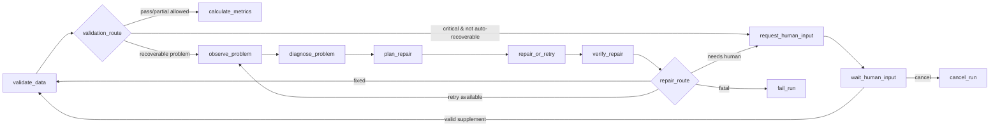
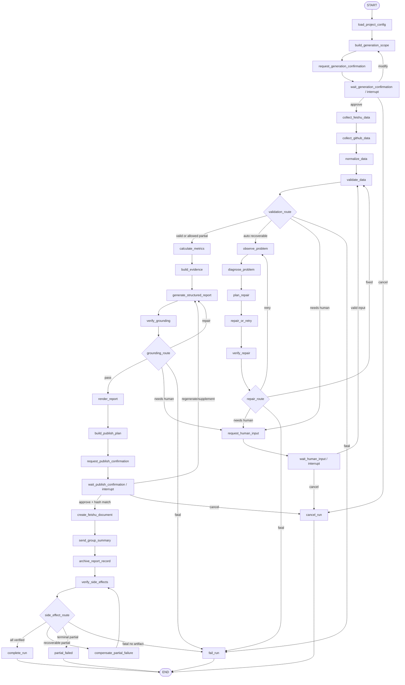

# 飞书项目周报 Agent：LangGraph 设计

> 文档编号：DESIGN-005  
> 对应需求：`01-feishu-project-weekly-agent-prd.md` v1.0  
> 状态：待评审  
> 核心原则：Graph 编排业务状态；确定性代码掌控权限、路由、指标、幂等和副作用

## 1. Graph 职责与非职责

LangGraph 负责：

- 将主流程、诊断循环、HITL interrupt 和发布恢复显式编排；
- 在节点之间传递小型、可序列化、无秘密的业务状态；
- 保存 Checkpoint 并从指定 thread 恢复；
- 通过条件边执行确定性状态路由；
- 记录 graph/node 级可观测信息。

LangGraph 不负责：

- 保存 GitHub PAT、飞书 Secret 或 LLM API Key；
- 保存完整 GitHub/多维表格原始数据；
- 用 LLM 决定权限、指标、重试次数或计划哈希；
- 直接把任意 LLM Tool Call 当作外部写入；
- 用 Checkpoint 代替运行数据库、审计表或副作用 ledger。

Graph 的启动输入只依赖已持久化的 `report_run`。该运行可以由 local-demo、管理员手动入口或 Scheduler 创建；Graph 不感知也不依赖具体触发来源。

## 2. Graph 标识与版本

- `thread_id`：每个 `report_run` 唯一且稳定，建议 `report-run:{run_id}`。
- `checkpoint_ns`：`weekly-report:{graph_version}`。
- `graph_version`：语义版本，如 `weekly_report.v1`。
- `state_schema_version`：整数，从 1 开始。
- `checkpoint_id`：由 Checkpointer 生成并映射到运行记录。

恢复时如果运行的 `graph_version/state_schema_version` 与当前 Worker 不兼容，运行进入安全失败/迁移流程，不用新 Graph 盲目加载旧状态。

## 3. State 设计

### 3.1 顶层 State

以下为逻辑结构，具体实现使用 `TypedDict`/Pydantic-compatible schema 和显式 reducers：

```text
WeeklyReportState
  schema_version: int
  run:
    run_id: UUID
    thread_id: str
    project_id: UUID
    requester_id: str
    graph_version: str
    current_stage: Stage
    config_revision: int
    scope_revision: int
  scope:
    report_period:
      start_at: datetime
      end_at: datetime
      timezone: str
    selected_repository_ids: list[UUID]
    feishu_resource_refs: list[UUID]
    user_instructions: str
    expected_publish_group_ref: UUID
    read_plan: list[ReadPlanItem]
    scope_hash: str
  refs:
    config_snapshot_ref: UUID
    source_batch_refs: list[UUID]
    normalized_snapshot_ref: UUID | null
    validation_result_ref: UUID | null
    metrics_ref: UUID | null
    evidence_set_ref: UUID | null
    report_version_ref: UUID | null
    rendered_report_ref: UUID | null
    publish_plan_ref: UUID | null
  validation:
    status: unknown | complete | partial | blocked
    critical_problem_keys: list[str]
    warning_keys: list[str]
  diagnosis:
    active_problem_key: str | null
    retry_counters: dict[str, int]
    diagnosis_record_refs: list[UUID]
    next_repair_action: str | null
  approval:
    active_approval_ref: UUID | null
    approval_type: generation | human_input | publish | null
    approval_revision: int
    status: none | pending | approved | rejected | cancelled | superseded
    approved_scope_hash: str | null
    approved_plan_hash: str | null
  publish:
    plan_hash: str | null
    operation_refs: list[UUID]
    next_operation_index: int
    side_effect_status: not_started | executing | verified | partial_failed
  control:
    requested_action: continue | regenerate | cancel | retry_failed | null
    resume_from: str | null
    cancel_requested: bool
  error:
    code: str | null
    summary: str | null
    retryable: bool
  timestamps:
    created_at: datetime
    last_transition_at: datetime
```

### 3.2 State 中禁止出现

- 任何明文 token/key/password；
- 外部 SDK client；
- 完整 API 原始响应、数千条 entity 或文档大正文；
- 未清洗的异常/堆栈；
- 任意可执行函数、动态 Tool 定义；
- 管理员密码、JWT 或飞书 callback 原始密文。

### 3.3 Reducer

- `source_batch_refs`, `diagnosis_record_refs`, `operation_refs`：按稳定 ID 去重追加。
- `retry_counters`：按 problem/tool key 合并，值只允许递增。
- `scope`, `approval`, `publish`, `error`：节点返回显式 patch，禁止隐式深合并产生旧字段残留。
- 每个节点返回最小 patch；大型输出先落 PostgreSQL，再把 ref 写入 State。

## 4. 节点与职责

### 4.1 范围与 HITL 1

| 节点 | 输入 | 输出/副作用 | 条件边 |
|---|---|---|---|
| `load_project_config` | run/project ref | 不含秘密的 config snapshot ref | 无有效配置→`fail_run`；否则 scope |
| `build_generation_scope` | config、period、override | scope + canonical `scope_hash` | →请求确认 |
| `request_generation_confirmation` | scope | 幂等发送/更新协调卡片，创建 approval | →等待 |
| `wait_generation_confirmation` | approval ref | `interrupt(generation_approval)` | resume 后按 action 路由 |

`request_generation_confirmation` 是协调副作用，不是业务发布。它必须可幂等重试，但不需要 HITL 2。

HITL 1 路由：

- `approve_generation` 且 scope hash 匹配 → `collect_feishu_data`
- `modify_generation_scope` → 校验 override → `build_generation_scope`
- `cancel_run` → `cancel_run`
- 非法/旧动作 → 不 resume，callback 层返回冲突

### 4.2 数据采集

`collect_feishu_data` 与 `collect_github_data` 在逻辑上独立。为控制实现复杂度，可采用：

- Graph 中顺序节点；
- 节点内部对最多 5 个 GitHub 仓库执行有界并发；
- 每仓库/实体类型单独落 batch 和 Tool execution。

不建议在 MVP 动态创建大量 Send 分支，以免 Checkpoint 和错误聚合过度复杂。顺序为飞书后 GitHub不影响语义；未来可在不改变 State 合约的前提下并行。

| 节点 | 关键行为 |
|---|---|
| `collect_feishu_data` | 按批准 read plan 读取逻辑表，schema hash 校验、分页落 batch |
| `collect_github_data` | 对选定仓库有界并发，单仓失败不阻断其他仓；落独立 batch/status |
| `normalize_data` | 字段映射、统一模型、去重、UTC 时间过滤，生成 snapshot ref |
| `validate_data` | 确定性规则，产出 validation ref 和问题 keys |

### 4.3 诊断循环



PRD 建议节点中的 `diagnose_problem` 和 `repair_or_retry` 保留；为体现 Observe/Plan/Verify，本设计增加三个小节点，不改变职责。

正常报告路径始终是 `validate_data → calculate_metrics → build_evidence → generate_structured_report`，不依赖诊断节点。实施时先交付校验通过的纵向路径，再逐步启用异常边和完整诊断循环；这只是交付顺序变化，不改变最终状态图。

路由由 `ProblemPolicyRegistry` 决定：

```text
problem_type -> criticality, retryable, max_attempts,
                allowed_actions, resume_node, escalation_schema
```

例：

| 问题 | 自动动作 | 上限后 |
|---|---|---|
| GitHub timeout/rate limit | 按 reset 时间退避并重试该仓/页 | 关键仓需人工；非关键仓可 partial |
| 单仓 permission denied | 不重试，继续其他仓 | 依据关键性请求补 PAT/调整范围 |
| 非关键飞书字段缺失 | 记录 warning，使用降级 | 继续生成并披露 |
| 关键字段缺失 | schema 重探测一次 | 人工补 mapping/数据 |
| 重复数据 | 用 stable key/content hash 去重 | 冲突不可判定时人工 |
| LLM schema invalid | 同输入有限修复/重新生成 | fail 或人工，不伪造 |
| ungrounded critical claim | 删除/降级 claim 或重建报告 | 仍失败则阻止发布 |

### 4.4 报告节点

| 节点 | 职责 | 确定性要求 |
|---|---|---|
| `calculate_metrics` | 计算 PRD 指标并存 metrics ref | 全部代码计算、有口径版本 |
| `build_evidence` | 形成 evidence set/claim candidates | 资源 ID、URL、周期、hash 可验证 |
| `generate_structured_report` | LLM 生成结构化中间结果 | JSON Schema 校验；只引用允许 evidence IDs |
| `verify_grounding` | 核验关键结论证据和周期 | 规则判断；LLM 可辅助语义一致性但无最终裁决权 |
| `render_report` | 从 verified structured report 生成自然语言 | 不得新增未在结构结果中的事实 |

`verify_grounding` 路由：

- 全部关键 claim 通过 → `render_report`
- 可修复（证据存在但结构引用错误）且次数未满 → `generate_structured_report`
- 无证据的非关键内容 → 标记 inference/needs_confirmation 后再核验
- 无证据关键事实或达到上限 → `request_human_input` 或 `fail_run`

### 4.5 发布计划与 HITL 2

| 节点 | 职责 |
|---|---|
| `build_publish_plan` | 从 verified report + 配置快照构造 canonical operations，冻结 payload/target refs，计算 hash |
| `request_publish_confirmation` | 保存 pending approval，发送预览卡片 |
| `wait_publish_confirmation` | `interrupt(publish_approval)` |

HITL 2 路由：

- `approve_publish`：重新计算并匹配 plan hash → `create_feishu_document`
- `regenerate_report`：旧 plan/approval invalidated → `generate_structured_report`
- `update_supplement`：清洗补充说明并生成新 report version → `generate_structured_report`
- `cancel_publish`：→ `cancel_run`

任何重新生成都产生新 `report_version`、新 `publish_plan.version` 和新 approval revision。

### 4.6 副作用节点

PRD 节点名保留为 Graph 语义节点，但实际网络写入委托给统一执行器：

| 节点 | operation | 前置条件 |
|---|---|---|
| `create_feishu_document` | `create_feishu_document` | approved hash 有效，前序无 |
| `send_group_summary` | `send_group_summary` | document operation 已 verified |
| `archive_report_record` | `upsert_bitable_archive` | 文档与消息状态满足计划依赖 |
| `verify_side_effects` | 查询 ledger/必要时外部核验 | 所有计划操作已尝试 |
| `compensate_partial_failure` | 向前恢复/再次核验 | 仅原批准计划 |

节点本身不直接调用飞书 SDK，而是：

1. 加载 operation；
2. `SideEffectExecutor.execute(operation_id, approved_plan_hash)`；
3. 保存 operation 状态；
4. 返回 State patch。

`verify_side_effects` 路由：

- 全部 confirmed → `complete_run`
- 存在 retryable failed → `compensate_partial_failure`
- 存在 unknown → verifier 查询；仍 inconclusive 则部分失败/人工卡片
- 存在 permanent failed 且已有部分成功 → `partial_failed` 终态
- 首个操作失败且无产物且不可恢复 → `fail_run`

## 5. 完整状态图



## 6. 条件边定义

条件边必须是纯函数：只读 State 中的小型状态和数据库中已验证的摘要，不调用 LLM/外部 API。

### 6.1 `generation_approval_route`

```text
cancel_requested                           -> cancel_run
action == modify_scope                     -> build_generation_scope
status == approved && scope_hash matches   -> collect_feishu_data
otherwise                                  -> fail-safe wait/no resume
```

### 6.2 `validation_route`

```text
critical problems empty && status complete -> calculate_metrics
critical problems empty && status partial
  && degradation policy allows             -> calculate_metrics
active problem recoverable
  && attempts < max                         -> observe_problem
problem requires supplement                -> request_human_input
otherwise                                  -> fail_run
```

### 6.3 `publish_approval_route`

```text
cancel                                     -> cancel_run
regenerate or supplement                   -> generate_structured_report
approved && recomputed_hash == approved     -> create_feishu_document
hash mismatch                              -> invalidate + request_publish_confirmation
otherwise                                  -> no resume
```

### 6.4 `side_effect_route`

基于持久化 operation ledger 汇总，不能只看 State 中的布尔值。

## 7. Interrupt 设计

### 7.1 统一 interrupt payload

```json
{
  "interrupt_id": "019...",
  "type": "generation_approval",
  "run_id": "019...",
  "approval_ref": "019...",
  "revision": 1,
  "presented_hash": "sha256...",
  "allowed_actions": [
    "approve_generation",
    "modify_generation_scope",
    "cancel_run"
  ],
  "display_ref": "019...",
  "input_schema": {},
  "expires_at": "2026-07-31T10:00:00Z"
}
```

Checkpoint 中保存引用和安全元数据，卡片展示内容从数据库 projection 读取。

### 7.2 Interrupt 前顺序

每个等待节点必须满足：

1. 生成展示内容并落库；
2. 创建 pending `human_approvals`；
3. 持久化当前 Graph State；
4. 幂等发送/更新卡片；
5. 调用 `interrupt()`；
6. node execution 记为 `interrupted`。

若卡片发送失败，不能产生一个用户不可见的永久等待：协调消息重试；达到上限将 run 标记为可运维恢复的失败/告警状态。

### 7.3 Resume payload

Graph 不接收未经验证的原始 callback，只接收 Approval Service 生成的引用：

```json
{
  "interrupt_id": "019...",
  "approval_ref": "019...",
  "decision_ref": "019...",
  "action": "approve_publish",
  "actor_ref": "ou_xxx",
  "validated_payload_ref": null,
  "decided_at": "2026-07-24T10:00:00Z"
}
```

敏感/大补充内容保存数据库，State 只存 ref。

### 7.4 Resume 前验证

1. `run_id/thread_id` 匹配；
2. run 是对应 waiting 状态；
3. interrupt/approval revision 是当前活动版本；
4. actor 已授权；
5. approval 决策未被消费；
6. scope/plan hash 从数据库重算后匹配；
7. graph/state schema 兼容；
8. 没有另一个 Worker 持有有效 run lease；
9. side-effect 阶段恢复额外核验 operation ledger。

然后使用相同 `thread_id` 和 `Command(resume=...)` 恢复。

## 8. Checkpoint 策略

### 8.1 必须持久化的位置

- 每个 HITL interrupt 前；
- 每个采集节点完成并已落 batch 后；
- 标准化、校验、指标、证据和每个报告版本完成后；
- 发布计划冻结后；
- 每个 side-effect operation 完成/失败/unknown 后；
- 终态前。

实际 Checkpointer 通常在 super-step 边界保存；节点设计应确保上述职责处于独立 super-step，不把多个不可重放操作塞进一个节点。

### 8.2 写入顺序

对无外部副作用节点：

1. 领域结果落库；
2. node 返回 ref patch；
3. Checkpointer 保存 State。

对外部副作用节点：

1. operation 意图已在发布计划阶段落库；
2. 执行器更新 operation 状态并调用外部平台；
3. 外部结果/unknown 落库；
4. node 返回 operation ref/status；
5. Checkpointer 保存。

如果 3 与 5 之间崩溃，重放节点先读 operation ledger，不重复执行 succeeded；unknown 先核验。

### 8.3 Checkpoint 与业务表的边界

Checkpoint 是恢复游标，不是唯一审计事实。审批、Tool、operation、report version 等先写业务表，再在 State 保存引用。后台不解析任意 Checkpoint 来展示业务详情。

## 9. 服务重启恢复

### 9.1 启动扫描

Recovery Scanner 查询：

- 所有 waiting 状态：确认 Checkpoint 存在，保持等待，不占 Worker；
- 活动执行状态且 lease 过期：派发 `SAFE_RECOVER_WORKFLOW`；
- `side_effect_operations.running` 且 heartbeat/超时：转核验；
- outbox pending：重新发布；
- terminal run：不 resume。

### 9.2 恢复分类

| 中断点 | 恢复动作 |
|---|---|
| 等待 HITL | 等待新 callback；旧卡片可按需重新发送 |
| 只读 Tool 中 | 重放节点，按 batch/tool execution 判断已完成页 |
| LLM 调用中 | 若没有有效 report version，可安全重调；有有效版本则复用 |
| 发布计划已冻结未审批 | 继续等待，重新验证计划未变化 |
| 副作用 pending | 执行下一项 |
| 副作用 running/unknown | 先 verifier，不直接重复 POST |
| 副作用 succeeded，Checkpoint 未写 | 读取 ledger，跳过网络调用 |

### 9.3 重复 Resume

Callback inbox、approval 原子消费和 run lease 三层保护。重复 resume 命令读取已消费 decision 后直接 ack，不调用 Graph。

## 10. 发布计划哈希

计划 hash 的输入只包含审批对象：

```json
{
  "schema_version": 1,
  "run_id": "...",
  "report_period": {
    "start_at": "...Z",
    "end_at": "...Z",
    "timezone": "Asia/Shanghai"
  },
  "report_version": 2,
  "content_hash": "...",
  "operations": [
    {
      "sequence": 1,
      "type": "create_feishu_document",
      "target": {},
      "payload_hash": "..."
    }
  ]
}
```

计算步骤：

1. 只选 schema 白名单字段；
2. 时间统一 UTC ISO 8601；
3. operations 按 `sequence`；
4. object key 按 canonical JSON 排序；
5. Unicode 使用 UTF-8，不做显示层格式化；
6. `SHA-256(canonical_bytes)`；
7. 保存 canonical plan、hash 和 schema version。

非审批相关的创建时间、数据库 ID、重试计数不进入 hash。

## 11. 再生成与缓存复用

- HITL 2 “重新生成”在批准范围未变、数据快照未过期且未要求刷新时，复用 normalized snapshot、metrics 和 evidence。
- 用户改变周期/仓库必须回到 HITL 1，并使旧数据和发布计划失效。
- 补充说明只影响 report version 及其后续节点。
- Grounding 修复只重跑 structured report/verify/render，不重新采集。
- 所有复用都比较 input/content hash，不能只凭节点名判断。

## 12. 取消

- wait 状态：resume `cancel`，进入 `cancel_run`。
- 采集/生成中：设置 durable `cancel_requested`；每个节点边界检查并进入取消。
- publishing 前：可以取消全部 pending operations。
- publishing 中：当前网络调用无法强制回滚；完成后 ledger 记录结果，剩余 pending 标 `cancelled`，run 根据已有产物形成真实状态和通知。
- `cancel_run` 不删除 Checkpoint、审批或产物。

## 13. 节点级幂等

每个节点定义 `node_input_hash` 与输出事实：

| 节点类型 | 重放策略 |
|---|---|
| 配置/范围 | 相同 input hash 复用 scope revision |
| 只读采集 | 复用完整 batch；仅补缺页/失败仓 |
| 标准化/指标 | 相同 snapshot/rule version 复用结果 |
| LLM 生成 | 相同 safe input hash 可复用 valid report version |
| 卡片发送 | 使用 approval revision/card purpose 幂等 |
| 发布写入 | 只通过 operation ledger 和 verifier |
| 终态 | 条件更新 `WHERE status not terminal` |

## 14. 测试策略

### 14.1 单元

- State schema/Reducer；
- 每条条件边；
- retry/escalation policy；
- canonical plan/hash；
- resume 验证；
- cancel 路由；
- State 敏感字段扫描。

### 14.2 Graph 集成

优先使用固定演示数据集、Fake Adapter + PostgreSQL Checkpointer，使真实飞书环境不可用时仍能开发完整主链。Fake 与真实 Adapter 使用同一契约。覆盖：

1. 正常两阶段流程；
2. scope 修改后旧审批失效；
3. 单仓失败后继续；
4. 自动诊断重试；
5. 人工补充从 validation 恢复；
6. LLM schema/grounding 回路；
7. regenerate 只重跑报告链；
8. plan hash 变化重新审批；
9. 每个副作用后进程崩溃；
10. 重复 resume；
11. 服务重启；
12. 取消各阶段。

### 14.3 不变量测试

- 未批准 HITL 1 时无正式数据采集；
- 未批准 HITL 2 时无业务发布 operation 执行；
- approved hash 不等于 current hash 时零副作用；
- succeeded operation 永不二次调用；
- State 序列化结果中无凭证模式/大 payload；
- terminal run 不可被普通 resume。

## 15. LangGraph 验收清单

- [ ] PRD 的 27 个职责全部由节点或明确拆分节点承载。
- [ ] Observe/Diagnose/Plan/Act/Verify/Continue-or-Escalate 可从轨迹观察。
- [ ] 三类 interrupt 都基于持久化 Checkpoint。
- [ ] Resume 验证 actor、状态、revision 和 hash。
- [ ] 大型数据和秘密不进入 State。
- [ ] 重启可恢复等待态和执行态。
- [ ] 每项副作用均可在 Checkpoint 滞后时安全重放。
- [ ] 报告重新生成不会无条件重复采集全部数据。
- [ ] 计划变化会强制新审批。
