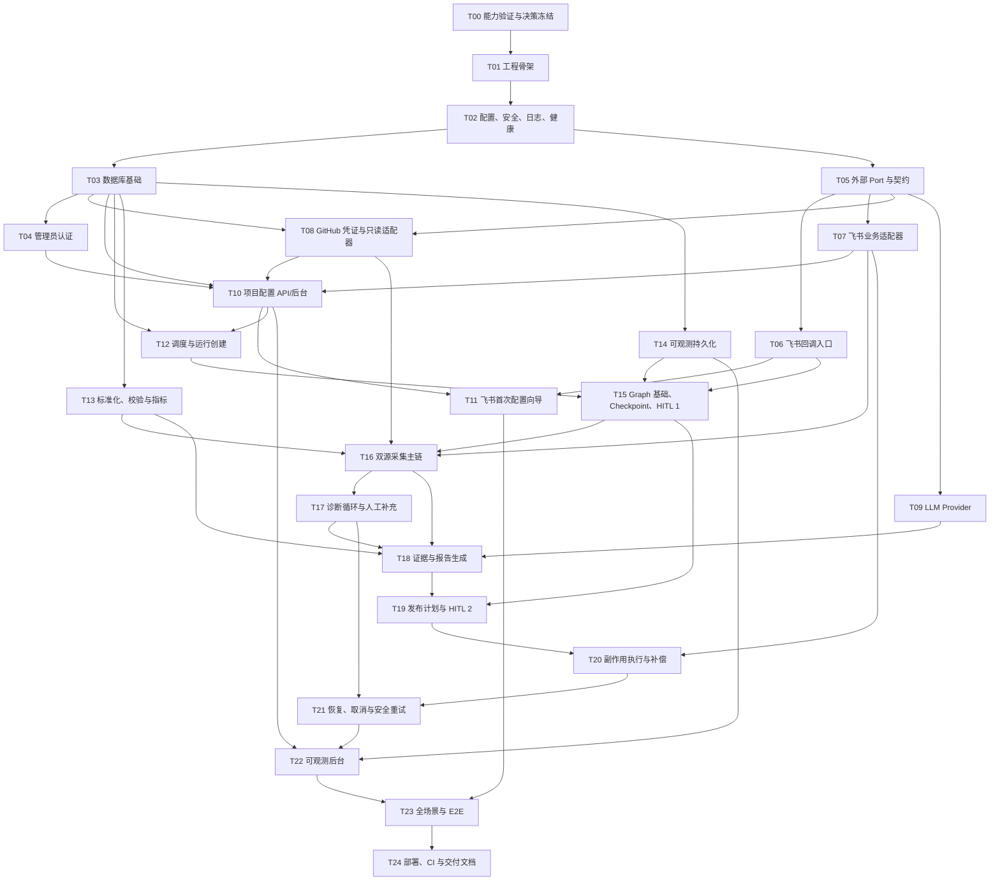

# 飞书项目周报 Agent：分阶段实施与测试计划

> 文档编号：PLAN-006  
> 对应需求：`01-feishu-project-weekly-agent-prd.md` v1.0  
> 依赖设计：`02-architecture-design.md`、`03-database-design.md`、`04-api-design.md`、`05-langgraph-design.md`  
> 状态：待评审；评审通过前不开始业务代码

## 1. 实施原则

1. 严格限定单企业、单项目、最多 5 个 GitHub 仓库的 MVP。
2. 先验证外部平台真实能力，再冻结协议适配器，不用猜测替代验证。
3. 每个 Task 是一个可独立评审、测试和提交的变更集。
4. 每个 Task 只实现其验收标准所需范围，不顺手加入未来功能。
5. 先建立确定性领域逻辑和安全边界，再接 LLM 与副作用。
6. 每个实现 Task 同时提交相关测试；测试不是最后一个阶段再补。
7. 数据库变更必须带 Alembic migration 和迁移测试。
8. 外部平台调用必须通过 Port，并有 Fake/Mock/录制后脱敏 fixture。
9. 未通过两阶段审批不允许在测试或实现中留“临时绕过”。
10. 每个 Task 提交前执行目标测试；每个 Phase 结束执行累计回归。

## 2. 阶段和依赖总览

可并行关系仅表示代码依赖允许，不表示扩大团队或范围：

- T06、T07、T08、T09 在 T05 后可分别推进。
- T13、T14 在 T03 后可分别推进。
- 每个合并点前必须通过对应契约测试。

## 3. Phase 0：外部能力验证与设计冻结

### T00 飞书/GitHub/LLM 能力 Spike 与开放问题决策

**目标**

用真实测试租户、测试仓库和目标 LLM 验证 `02-architecture-design.md` 第 4、5 节列出的能力；关闭会改变协议、权限或数据口径的开放问题。

**涉及文件**

- `docs/07-capability-validation-report.md`
- `docs/08-decision-log.md`
- `backend/tests/contract/fixtures/feishu/`（脱敏样例）
- `backend/tests/contract/fixtures/github/`（脱敏样例）
- `backend/tests/contract/fixtures/llm/`（脱敏样例）
- `scripts/spikes/`（仅最小验证脚本，实施阶段创建）

**实现步骤**

1. 创建隔离的飞书测试应用、用户、群、多维表格和文档目标。
2. 验证 challenge、事件/卡片回调字段、重复投递、卡片更新及用户身份。
3. 验证多维表格 schema/类型/分页/upsert，文档分块写入和群消息结果标识。
4. 用 Fine-grained PAT 对至少两个仓库验证各只读 endpoint、分页、限流和错误码。
5. 验证目标 LLM 的 OpenAI 兼容、JSON schema/structured output、usage 和 timeout 行为。
6. 对 A-01 至 A-20 给出 `accepted/rejected/deferred` 结论；未决且阻断开发的项升级评审。
7. 保存脱敏协议样例，不保存秘密或真实敏感业务数据。

**测试方式**

- 执行 Spike checklist；
- 对 fixture 运行 secret scanner；
- 人工复核权限清单与平台控制台配置；
- 重复发送相同 callback，记录平台和服务预期行为。

**验收标准**

- 飞书/GitHub 必需能力均有成功或明确降级结论。
- 权限清单和已验证错误码可供适配器实现。
- 阻断型歧义均已决策。
- fixture 无 token、secret、个人敏感数据。

**依赖关系**

- 前置：五份设计文档评审通过。
- 后续：T01、T05；若关键能力缺失，先回修设计，不进入编码。

## 4. Phase 1：工程基础

### T01 Monorepo、工具链和测试骨架

**目标**

建立可启动、可测试的 FastAPI + Next.js + Docker Compose 工程骨架，不实现业务流程。

**涉及文件**

- `backend/pyproject.toml`, `backend/app/main.py`, `backend/tests/`
- `frontend/package.json`, `frontend/src/app/`
- `docker-compose.yml`, `.env.example`, `.gitignore`
- `Makefile` 或等价跨平台任务入口

**实现步骤**

1. 固定 Python/Node/LangGraph 等核心版本。
2. 初始化 FastAPI 与 Next.js TypeScript/Tailwind。
3. 配置 formatter、linter、type checker 和测试框架。
4. 定义 `api/worker/scheduler/frontend/postgres/redis` Compose 服务骨架。
5. 添加最小 smoke tests 和统一命令。

**测试方式**

- 后端 lint/type/unit smoke；
- 前端 lint/type/build；
- `docker compose config`；
- 本地启动后检查空白首页和 API process。

**验收标准**

- 全新环境按 README 命令可安装并运行 smoke tests。
- 前后端 build 通过。
- 未出现业务逻辑或真实 secret。

**依赖关系**

- 前置：T00。
- 后续：T02。

### T02 配置、加密、脱敏、日志和健康检查

**目标**

建立所有后续模块依赖的安全配置和可观测基础。

**涉及文件**

- `backend/app/core/config.py`, `core/errors.py`
- `backend/app/security/encryption.py`, `security/redaction.py`
- `backend/app/observability/logging.py`
- `backend/app/api/health/routes.py`, `backend/app/api/errors.py`
- 对应 `backend/tests/unit/`

**实现步骤**

1. 定义环境配置 schema 和启动时必填校验。
2. 实现带 key version 的 AEAD 加解密服务。
3. 建立递归敏感字段脱敏和异常安全摘要。
4. 建立 JSON 结构化日志及 request/run context。
5. 实现 `/health`、`/ready` 和统一错误响应。

**测试方式**

- 加解密 round-trip、错误 key、tamper 检测；
- 多层对象/URL/header 脱敏；
- 错误响应不含堆栈；
- health/ready 在依赖正常/异常时行为测试。

**验收标准**

- secret 不出现在日志、异常或 API 响应 fixture。
- 缺失必需环境配置时 fail fast。
- `/health` 与 `/ready` 语义不同且不泄露内部细节。

**依赖关系**

- 前置：T01。
- 后续：T03、T05。

### T03 PostgreSQL 模型、迁移、Repository/UoW 与 Redis 基础

**目标**

实现 `03-database-design.md` 中的核心 schema、事务边界和 Redis 命名/锁基础。

**涉及文件**

- `backend/app/persistence/db.py`
- `backend/app/persistence/models/`
- `backend/app/persistence/repositories/`
- `backend/app/persistence/migrations/`
- `backend/app/scheduling/locks.py`
- `backend/tests/integration/persistence/`

**实现步骤**

1. 分组实现配置、运行、观测、审批、报告、发布、inbox/outbox 表。
2. 添加状态 CHECK、唯一约束、partial indexes 和外键。
3. 实现 UoW 及首批 repository ports。
4. 实现 Redis run/period lease，数据库约束作为最终防线。
5. 添加迁移升级、回滚和索引检查。

**测试方式**

- 空库 migrate up/down/up；
- 约束和并发插入测试；
- 事务 rollback；
- Redis lease 获取、续租、过期；
- ORM 查询无 N+1 基础检查。

**验收标准**

- schema 与数据库设计文档一致，差异有 ADR。
- 同周期活动 run 无法重复插入。
- Redis 丢失不破坏数据库事实。
- migration 在 CI PostgreSQL 上通过。

**依赖关系**

- 前置：T02。
- 后续：T04、T08、T10、T12、T13、T14。

### T04 单管理员认证与 Session

**目标**

实现安全登录、刷新、登出和后台路由保护，不引入复杂 RBAC。

**涉及文件**

- `backend/app/api/admin/auth.py`
- `backend/app/security/jwt.py`
- `backend/app/application/services/auth.py`
- `frontend/src/features/auth/`, `frontend/src/app/login/`
- 对应单元/集成测试

**实现步骤**

1. 实现密码哈希、失败计数、锁定和管理员初始化流程。
2. 实现短期 access token 和旋转 refresh session。
3. 配置 HttpOnly/Secure/SameSite Cookie 与 CSRF/Origin 校验。
4. 实现登录页和受保护 layout。
5. 记录登录安全审计。

**测试方式**

- 正确/错误登录、锁定、刷新旋转、撤销；
- 伪造/过期 token；
- CSRF/Origin；
- 前端 auth route 测试。

**验收标准**

- 生产启动不提供默认弱密码。
- 被撤销 session 无法刷新。
- 受保护 API 未认证返回统一 401。

**依赖关系**

- 前置：T03。
- 后续：T10、T22。

## 5. Phase 2：平台集成

### T05 外部 Port、Tool 抽象与契约测试框架

**目标**

定义飞书、GitHub、LLM 的稳定 Port，以及只读 Tool 执行的 schema、超时、重试和脱敏记录边界。

**涉及文件**

- `backend/app/tools/base.py`, `registry.py`, `executor.py`
- `backend/app/integrations/*/models.py`
- `backend/tests/contract/`
- `backend/tests/fakes/`

**实现步骤**

1. 定义 `ToolSpec/ToolContext/ToolResult` 和错误 taxonomy。
2. 定义 Feishu/GitHub/LLM Protocol，不引用具体 SDK 类型。
3. 实现 Tool Registry 白名单、输入输出 schema 校验。
4. 实现 timeout、指数退避、限流等待和脱敏 execution hook。
5. 建立 Fake adapter 与 fixture 驱动契约测试。

**测试方式**

- schema 错误、timeout、retryable/permanent error；
- 最大 3 次和退避时钟 fake；
- secret 永不进入 Tool execution 摘要；
- Fake 与真实适配器共享契约套件。

**验收标准**

- 领域/Graph 层不依赖平台 SDK。
- LLM 无法注册新 Tool。
- 重试策略由代码决定且可测试。

**依赖关系**

- 前置：T02、T00 fixture。
- 后续：T06、T07、T08、T09。

### T06 飞书回调验证、Inbox 幂等和异步派发

**目标**

安全接收飞书事件与卡片动作，在 3 秒内验证、去重并异步派发。

**涉及文件**

- `backend/app/api/feishu/events.py`, `cards.py`, `verification.py`
- `backend/app/persistence/repositories/callbacks.py`
- `backend/app/persistence/outbox/`
- `backend/tests/integration/feishu_callbacks/`

**实现步骤**

1. 按 T00 结果实现 challenge、验签/解密和时间窗。
2. 标准化 event/action DTO。
3. 事务写 `callback_events + outbox`。
4. 对重复 event/challenge 原子返回已处理。
5. 加入 actor/action 白名单入口，具体 approval 消费在 T15/T19。

**测试方式**

- 真实脱敏 fixture；
- 签名错误、过期、篡改、重复、并发重复；
- outbox 发布失败后恢复；
- 回调性能测试 P95 < 3 秒。

**验收标准**

- 重复 callback 只产生一条有效命令。
- 非法 callback 无业务状态变化。
- 处理链不调用耗时 Graph 或外部发布。

**依赖关系**

- 前置：T03、T05。
- 后续：T11、T15。

### T07 飞书消息、卡片、多维表格和文档适配器

**目标**

实现飞书所需读写 Port，保留统一错误、分页、外部 ID 和核验能力。

**涉及文件**

- `backend/app/integrations/feishu/`
- `backend/app/tools/read/feishu_bitable.py`
- `backend/tests/contract/test_feishu_adapter.py`

**实现步骤**

1. 实现 tenant token 缓存/刷新。
2. 实现私聊/群消息、卡片发送更新。
3. 实现多维表格 schema、分页读取、按 Run ID 查询/upsert。
4. 实现文档创建、分块写入和结果查询/核验。
5. 映射限流、权限、not found、timeout 和 unknown。

**测试方式**

- fixture 契约测试；
- 分页、空表、公式/人员/日期字段；
- token 刷新并发；
- 文档中途失败续写；
- sandbox 真实集成 smoke。

**验收标准**

- 每种写操作返回稳定 external ID 或明确 `unknown`。
- 适配器不包含审批判断。
- 所有响应日志已脱敏。

**依赖关系**

- 前置：T05、T00。
- 后续：T10、T11、T16、T20。

### T08 GitHub PAT 生命周期与多仓库只读适配器

**目标**

安全保存/更新 PAT，并采集 PRD 必需的 GitHub 数据。

**涉及文件**

- `backend/app/integrations/github/`
- `backend/app/tools/read/github.py`
- `backend/app/application/services/credentials.py`
- 对应 API、contract/integration tests

**实现步骤**

1. 实现 PAT write-only 加密存储、更新、失效/权限检测。
2. 实现 repo metadata、issues、PRs、reviews、commits、milestones、contributors。
3. 实现分页、`since/until`、限流 header、ETag 和采集上限。
4. 对最多 5 仓有界并发；保留单仓状态。
5. 排除 Issues API 混入的 PR，并保存稳定 external ID。

**测试方式**

- 分页/时间边界/大数据上限；
- rate limit、secondary limit、timeout、403/404；
- 一个仓库失败其他继续；
- PAT 永不出现在日志/State/响应；
- 真实测试仓库 smoke。

**验收标准**

- 至少两个仓库数据可独立采集和标记质量。
- PAT 权限不足给出具体 capability。
- 所有请求有独立 timeout 和最多 3 次策略。

**依赖关系**

- 前置：T03、T05、T00。
- 后续：T10、T16。

### T09 OpenAI 兼容 LLM Provider

**目标**

实现厂商无关的结构化/非结构化调用、usage 和失败分类，默认配置 DeepSeek。

**涉及文件**

- `backend/app/integrations/llm/provider.py`
- `backend/app/integrations/llm/openai_compatible.py`
- `backend/app/integrations/llm/schemas.py`
- contract/unit tests

**实现步骤**

1. 实现配置项和 Provider Protocol。
2. 实现 structured output；不支持原生 schema 时使用受控 JSON fallback。
3. 实现 timeout、有限重试、stream/non-stream 和 token usage。
4. 输出先 schema 校验，再落安全引用。
5. 记录 model/prompt version/hash，不记录秘密。

**测试方式**

- 合法/非法 JSON、截断、timeout、429；
- usage 缺失和兼容差异；
- provider fake；
- Prompt/日志 secret scan。

**验收标准**

- 业务代码不引用 DeepSeek 模型名或厂商 SDK。
- schema 无效不能进入报告链下一步。
- token 与耗时可观测。

**依赖关系**

- 前置：T05、T00。
- 后续：T18。

## 6. Phase 3：项目配置与调度

### T10 项目配置、字段映射、连通性 API 与后台页面

**目标**

让单管理员在 Web 后台安全配置项目、仓库、飞书资源、映射、定时规则和 Prompt。

**涉及文件**

- `backend/app/api/admin/projects.py`, `repositories.py`, `resources.py`, `schedules.py`, `prompts.py`, `connectivity.py`
- `backend/app/application/commands/`, `queries/`
- `frontend/src/features/project-config/`, `frontend/src/app/project/`
- API/前端测试

**实现步骤**

1. 实现 `04-api-design.md` 的配置 CRUD 与 revision。
2. 实现字段 mapping 的 logical schema 校验。
3. 聚合 GitHub/飞书/LLM capability test。
4. 实现配置确认摘要和审计。
5. 实现后台表单、秘密 write-only UI 和错误展示。

**测试方式**

- API schema、revision 冲突、最多 5 仓；
- 旧 schema hash 拒绝；
- 凭证不回显；
- 前端表单与 Mock API；
- 集成连通性测试。

**验收标准**

- 无硬编码中文飞书字段、仓库或群 ID。
- 配置变化不改变已创建 run snapshot。
- 所有配置修改有审计。

**依赖关系**

- 前置：T03、T04、T07、T08、T09。
- 后续：T11、T12、T22。

### T11 飞书首次配置向导

**目标**

管理员可通过机器人对话/卡片逐步完成同一套配置，并在最终确认后持久化。

**涉及文件**

- `backend/app/application/services/onboarding.py`
- `backend/app/integrations/feishu/cards/` 或模板目录
- `backend/app/domain/projects/onboarding.py`
- scenario tests

**实现步骤**

1. 定义有限状态向导和每步 input schema。
2. 复用 T10 的 command/capability services，不复制配置逻辑。
3. 每步即时验证 PAT、仓库、表、字段、群、文档和 schedule。
4. 最终生成摘要，管理员明确确认后事务持久化。
5. 重复/回退/取消安全处理。

**测试方式**

- 正常、回退、非法输入、过期卡片、重复确认；
- 中途服务重启恢复向导；
- 非管理员操作拒绝；
- Fake Feishu scenario。

**验收标准**

- PRD 首次配置字段全部覆盖。
- 未最终确认不激活配置。
- Web 与飞书写入同一领域模型和审计路径。

**依赖关系**

- 前置：T06、T10。
- 后续：T23。

### T12 周期计算、Scheduler、唯一运行创建与 Outbox

**目标**

按项目时区每周创建唯一运行，并可靠派发启动命令。

**涉及文件**

- `backend/app/scheduling/scheduler.py`, `periods.py`
- `backend/app/application/services/run_creation.py`
- `backend/app/workers/jobs.py`
- unit/integration tests

**实现步骤**

1. 实现 `[start,end)` 周期计算和 DST/timezone 测试。
2. Scheduler 读取 enabled config 并创建 run/config snapshot。
3. 事务写 run + outbox。
4. DB unique + Redis lock 处理重复触发。
5. 实现 misfire `skip/fire_once` 和任务派发。

**测试方式**

- 时区、年/月边界、DST；
- 两 scheduler 并发；
- outbox 发布崩溃恢复；
- 同周期返回同一活动 run。

**验收标准**

- 同项目同周期最多一个活动 run。
- 人工等待不计 active elapsed。
- Redis 清空后不产生重复 run。

**依赖关系**

- 前置：T03、T10。
- 后续：T15。

## 7. Phase 4：确定性报告基础与 Agent 主链

### T13 标准化、字段映射、数据质量、指标和证据基础

**目标**

先实现不依赖 Graph/LLM 的纯确定性报告核心。

**涉及文件**

- `backend/app/reports/normalization/`
- `backend/app/reports/validation/`
- `backend/app/reports/metrics/`
- `backend/app/reports/evidence/`
- `backend/tests/unit/reports/`
- 固定数据集 fixtures

**实现步骤**

1. 定义统一 entity 和成员映射。
2. 实现去重、UTC 时间过滤和冲突保留。
3. 定义 critical/required/optional 规则集。
4. 明确口径版本并实现 PRD 11 项指标。
5. 实现 claim/evidence 数据结构和 URL/周期校验。

**测试方式**

- 表驱动和 property-based 边界测试；
- Issue/PR 混入、重复、空分母、时间端点；
- 多仓聚合和单仓 partial；
- 指标 golden files。

**验收标准**

- 指标全部由代码计算且结果可重复。
- 规则能区分 complete/partial/blocked。
- 每个关键指标可关联来源快照。

**依赖关系**

- 前置：T03，A-05/A-07/A-08 决策。
- 后续：T16、T18。

### T14 Node/Tool/LLM/审计可观测持久化

**目标**

提供 Graph 和后台统一的观测写入服务与脱敏 projection。

**涉及文件**

- `backend/app/observability/`
- `backend/app/persistence/repositories/executions.py`
- `backend/app/api/admin/runs.py` 的只读基础
- integration tests

**实现步骤**

1. 实现 node/tool/LLM execution recorder。
2. 实现 run status history 和 audit service。
3. 实现 request/run/node context propagation。
4. 建立基础指标 endpoint。
5. 建立后台脱敏查询 projection。

**测试方式**

- 嵌套上下文并发隔离；
- 失败时 recorder 不吞原异常；
- secret scanner；
- 按 run_id 关联完整性。

**验收标准**

- 一次 fake run 的所有 execution 可用 run_id 串联。
- 后台 projection 不包含原始秘密/堆栈。
- 观测写入失败有降级告警但不伪造业务成功。

**依赖关系**

- 前置：T03。
- 后续：T15、T22。

### T15 LangGraph State、Postgres Checkpointer、HITL 1

**目标**

建立可启动、interrupt、resume 和重启恢复的 Graph 骨架，完成第一阶段范围审批。

**涉及文件**

- `backend/app/agent/state/`
- `backend/app/agent/graph/`
- `backend/app/agent/nodes/scope.py`, `approvals.py`, `terminal.py`
- `backend/app/persistence/checkpoint/`
- graph integration tests

**实现步骤**

1. 实现 State schema/reducers/version。
2. 固定 LangGraph/Postgres checkpointer 版本并迁移。
3. 实现 load config、build scope、request/wait generation confirmation。
4. Approval Service 验证 actor/revision/scope hash，使用 `Command(resume=...)`。
5. 实现 modify/cancel 路由和重启恢复。

**测试方式**

- State 序列化和敏感扫描；
- approve/modify/cancel；
- 重复 callback/resume；
- 旧 revision/hash；
- interrupt 后重启新进程恢复。

**验收标准**

- HITL 1 前不执行正式数据采集。
- 修改范围产生新 revision，旧卡片无效。
- 等待态重启后可恢复。

**依赖关系**

- 前置：T06、T12、T14。
- 后续：T16、T19。

### T16 双数据源采集、标准化和校验 Graph 主链

**目标**

从批准范围读取飞书与多个 GitHub 仓库，落批次引用并完成标准化/校验。

**涉及文件**

- `backend/app/agent/nodes/collection.py`, `validation.py`
- `backend/app/application/services/data_collection.py`
- `backend/app/persistence/repositories/source_data.py`
- graph/scenario tests

**实现步骤**

1. 实现 Feishu/GitHub 节点和每页/每仓结果持久化。
2. GitHub 最多 5 仓有界并发，单仓失败保留状态。
3. 实现 normalize/validate nodes，State 只写 refs。
4. 输入 hash 相同复用完整批次；失败页单独补采。
5. 连接 validation 条件边。

**测试方式**

- 正常双源、多页、单仓失败、schema 变化；
- 节点中途崩溃后只补未完成部分；
- State 大小阈值；
- 采集上限和 timeout。

**验收标准**

- 原始大数据不进入 Checkpoint。
- 单仓失败不丢其他仓结果。
- 数据质量结果可确定性复现。

**依赖关系**

- 前置：T07、T08、T13、T15。
- 后续：T17、T18。

## 8. Phase 5：Agent Loop

### T17 Observe-Diagnose-Plan-Act-Verify 与人工补充

**目标**

实现白名单化诊断循环、自动重试/降级和达到上限后的精确人工补充。

**涉及文件**

- `backend/app/agent/nodes/diagnosis.py`
- `backend/app/agent/policies/retry.py`, `data_quality.py`, `recovery.py`
- `backend/app/approvals/` 的 human_input
- 数据缺失卡片模板与 scenario tests

**实现步骤**

1. 建立 problem taxonomy 和 policy registry。
2. 拆分 Observe/Diagnose/Plan/Act/Verify 节点。
3. 实现指数退避、单问题计数和降级规则。
4. 生成人工补充 schema、已尝试动作和恢复节点说明。
5. 补充输入校验后从现有 checkpoint 恢复 validation。

**测试方式**

- timeout 后成功、限流、权限失败、非关键缺失、关键缺失；
- 重试精确上限；
- 非白名单 repair action 拒绝；
- 人工补充非法/合法、重复提交；
- 重启后补充恢复。

**验收标准**

- 轨迹能观察完整 Agent Loop。
- 关键数据缺失不降级伪造。
- 人工补充不会重跑所有成功步骤。

**依赖关系**

- 前置：T16。
- 后续：T18、T21。

## 9. Phase 6：报告、发布与可靠性

### T18 结构化报告、证据绑定、Grounding 和渲染

**目标**

从已验证数据生成符合 schema、证据可追溯的报告版本。

**涉及文件**

- `backend/app/reports/generation/`
- `backend/app/reports/verification/`
- `backend/app/reports/rendering/`
- `backend/app/agent/nodes/reporting.py`
- report/scenario tests

**实现步骤**

1. 构造安全、限长、带来源边界的 LLM 输入。
2. 生成 PRD 结构化中间结果并持久化版本。
3. 确定性检查 evidence ID、URL、周期、claim type。
4. 对 schema invalid/ungrounded 执行有限重建。
5. 只从 verified structured report 渲染正文。

**测试方式**

- golden structured reports；
- invalid JSON、未知 evidence ID、无证据关键 claim；
- Prompt Injection fixture；
- renderer 不新增事实；
- token/timeout 记录。

**验收标准**

- 每项关键结论有证据或被明确标推测/待确认。
- 无证据关键事实无法进入发布计划。
- LLM 不计算指标。

**依赖关系**

- 前置：T09、T13、T16、T17。
- 后续：T19。

### T19 Canonical 发布计划、计划哈希与 HITL 2

**目标**

冻结报告版本、目标和操作序列，完成发布预览、审批和变化后重新审批。

**涉及文件**

- `backend/app/side_effects/planner.py`, `canonicalize.py`
- `backend/app/agent/nodes/approvals.py`, `publishing.py` 的计划部分
- 发布确认卡片模板
- unit/graph tests

**实现步骤**

1. 定义 publish plan schema 和 canonical JSON。
2. 生成三个批准操作及各 payload/target hash。
3. 创建 approval revision，展示 report/目标/plan hash。
4. 实现 approve/regenerate/supplement/cancel 路由。
5. Resume 时从数据库重新计算 hash；变化则 invalidated 并重新发卡。

**测试方式**

- canonicalization golden tests；
- 字段顺序/Unicode/时区稳定性；
- target/content/operation/period 任一变化；
- 重复审批、旧卡片、越权 actor；
- regenerate 的版本和缓存复用。

**验收标准**

- 相同计划跨进程产生相同 hash。
- 未批准或 hash 变化时零业务写操作。
- 重新生成产生新报告/计划/审批 revision。

**依赖关系**

- 前置：T15、T18。
- 后续：T20。

### T20 统一副作用执行器、核验、幂等和部分失败补偿

**目标**

安全执行飞书文档、群消息和归档，支持崩溃、超时和部分失败后的向前恢复。

**涉及文件**

- `backend/app/side_effects/executor.py`, `verifier.py`, `compensation.py`
- `backend/app/side_effects/handlers/`
- `backend/app/agent/nodes/publishing.py`
- integration/scenario tests

**实现步骤**

1. 实现 operation ledger 和唯一 idempotency key。
2. 执行前验证 run/approval/plan hash/顺序/target/payload。
3. 三个 handler 只通过 Feishu Port。
4. 外部成功后保存 artifact；timeout 进入核验。
5. 实现文档成功消息失败、归档失败和 unknown 的向前恢复。

**测试方式**

- 每个网络调用前后注入进程崩溃；
- 重复 node/resume；
- timeout 但外部成功；
- 文档/消息/归档各组合部分失败；
- 计划 hash 变化；
- 并发两个 Worker。

**验收标准**

- succeeded operation 永不重复外部调用。
- 不盲目重发 unknown 消息。
- 已完成产物真实保留并可审计，不伪造回滚。
- 全部 verified 才进入 `succeeded`。

**依赖关系**

- 前置：T07、T19。
- 后续：T21。

### T21 服务重启恢复、取消、安全重试和生命周期清理

**目标**

补齐生产可靠性闭环：扫描过期执行、恢复 Checkpoint、取消剩余操作和安全清理。

**涉及文件**

- `backend/app/application/services/recovery.py`
- `backend/app/workers/runner.py`
- `backend/app/api/admin/runs.py` 控制端点
- `backend/app/persistence/cleanup/`
- integration tests

**实现步骤**

1. 实现 run lease/heartbeat 和 recovery scanner。
2. 分类恢复 waiting、read、LLM、pending/running/unknown side effect。
3. 实现 durable cancel flag 和节点边界检查。
4. 实现 `safe-retry`，只重放允许的节点/原计划操作。
5. 实现按设计保留期的分批清理和审计。

**测试方式**

- 杀进程/重启容器；
- Redis flush 后恢复；
- 各阶段取消；
- terminal run 重试拒绝；
- cleanup 不删等待态/unknown。

**验收标准**

- 等待审批和执行中 run 可在重启后正确恢复。
- 正式发布中取消只阻止未开始操作。
- 安全重试不绕过审批、不重复发布。

**依赖关系**

- 前置：T17、T20。
- 后续：T22、T23。

## 10. Phase 7：可观测后台

### T22 仪表盘、运行列表和完整运行详情

**目标**

实现 PRD 定位的 Agent 可观测/调试后台，不建设完整项目管理或 BI。

**涉及文件**

- `backend/app/api/admin/runs.py`
- `backend/app/application/queries/run_observability.py`
- `frontend/src/app/dashboard/`, `frontend/src/app/runs/`
- `frontend/src/features/workflow-trace/`, `tool-executions/`, `approvals/`
- API/UI tests

**实现步骤**

1. 实现 dashboard 聚合和 run cursor 查询。
2. 实现 timeline、node、Tool、LLM、diagnosis、approval、evidence、plan、side-effect、artifact 端点。
3. 实现状态筛选和活动 run 轮询。
4. 实现流程时间线、详情抽屉和外部产物链接。
5. 展示脱敏参数、token、耗时、重试和 plan hash。

**测试方式**

- API 查询性能与索引；
- 各状态 fixture 的 UI component tests；
- secret/stack 不可见；
- P95 基准；
- 可访问性基本检查。

**验收标准**

- PRD 运行详情字段全部可查看。
- 普通后台查询目标 P95 < 800ms（MVP 数据规模）。
- 不提供绕过 Graph 修改状态的 UI。

**依赖关系**

- 前置：T04、T10、T14、T21。
- 后续：T23。

## 11. Phase 8：系统验收与部署

### T23 固定数据集、Agent 全场景和半自动 E2E

**目标**

将 PRD 14 个 Agent 场景和完整演示闭环固化为可重复证据。

**涉及文件**

- `backend/tests/scenarios/`
- `backend/tests/fixtures/datasets/`
- `tests/e2e/`
- `docs/09-test-evidence.md`
- `docs/10-demo-runbook.md`

**实现步骤**

1. 建立无敏感信息的固定 GitHub/飞书数据集。
2. 实现 14 个场景测试和关键不变量断言。
3. 实现至少一条真实 sandbox 半自动 E2E。
4. 记录运行 ID、截图/日志摘要、测试版本和限制。
5. 执行 secret、dependency 和安全边界测试。

**测试方式**

- 见第 14 节测试矩阵；
- 重复发布按钮和服务重启作为强制演示步骤；
- 真实外部写入只指向隔离 sandbox。

**验收标准**

- PRD 20.3 的 14 个场景全部有通过证据。
- 一条流程覆盖配置/触发/HITL/采集/报告/发布/后台。
- 失败证据可定位到节点、Tool、审批和 operation。

**依赖关系**

- 前置：T11、T22。
- 后续：T24。

### T24 Docker 生产配置、CI、备份恢复与交付文档

**目标**

形成可一键启动、自动测试、构建镜像和演示恢复的交付包。

**涉及文件**

- `docker-compose.yml`, `deploy/nginx/`, `deploy/docker/`
- `.github/workflows/`
- `.env.example`
- `README.md`
- `docs/11-deployment.md`, `docs/12-operations-runbook.md`

**实现步骤**

1. 完成多阶段镜像、非 root、healthcheck 和 Nginx HTTPS 配置示例。
2. CI 执行 lint/type/unit/integration/frontend build/migration/image build。
3. 增加 dependency/secret scan 和 SBOM（CI 能力允许时）。
4. 编写环境变量、飞书/GitHub 配置、备份恢复和 key rotation 文档。
5. 实演 PostgreSQL 恢复、等待审批 run 恢复和 unknown operation 核验。

**测试方式**

- 全新机器 `docker compose up`；
- CI clean run；
- 容器重启、PostgreSQL restore；
- 端口/公网路由和默认凭证检查。

**验收标准**

- Docker Compose 一键启动并通过 ready。
- 无默认弱密码或镜像内 secret。
- CI 核心测试和镜像构建通过。
- 运维文档能复现备份与恢复。

**依赖关系**

- 前置：T23。
- 后续：MVP 最终验收。

## 12. 每个 Task 的提交规则

每个 Task 的提交必须满足：

1. 变更只覆盖该 Task；若发现前置设计缺口，先更新设计/ADR。
2. 实现与测试同提交，migration 与模型同提交。
3. 提交信息建议：`<type>(Txx): <objective>`。
4. PR/提交说明列出：
   - 输入与输出；
   - API/schema 变化；
   - 安全影响；
   - 执行的测试命令和结果；
   - 未解决限制。
5. 不提交 `.env`、真实 token、真实飞书/GitHub payload 或个人数据。
6. Phase gate 未通过，不开始依赖它的高风险 Task。

## 13. Phase Exit Gates

| Phase | 退出条件 |
|---|---|
| 0 | 外部能力和阻断型口径已确认 |
| 1 | 工程、迁移、安全配置、登录可测试运行 |
| 2 | 三类 adapter 通过共享契约，回调可安全去重 |
| 3 | Web/飞书配置路径一致，定时只创建唯一 run |
| 4 | HITL 1、双源采集、确定性校验可从 Checkpoint 恢复 |
| 5 | 自动诊断和人工补充场景通过 |
| 6 | Grounded report、HITL 2、三副作用和部分失败通过 |
| 7 | 后台显示完整链路且不泄密 |
| 8 | 14 场景、E2E、性能、安全、Compose 和恢复证据齐全 |

## 14. 测试计划

### 14.1 测试分层

| 层级 | 目标 | 执行频率 |
|---|---|---|
| Unit | 纯函数、策略、状态路由、hash、脱敏 | 每次提交 |
| Component | Application service + Fake ports | 每次提交 |
| Contract | Adapter 对平台 fixture/测试租户行为 | Adapter 变更、每日/手动真实 smoke |
| Integration | PostgreSQL、Redis、Checkpointer、回调、outbox | 每个 PR/提交集 |
| Graph scenario | 全节点、interrupt/resume、错误循环 | 每个 Graph 相关 PR |
| E2E | 真实飞书/GitHub sandbox 完整闭环 | 发布候选 |
| Non-functional | 性能、安全、恢复、容量 | Phase 结束和发布候选 |

### 14.2 PRD 14 个 Agent 场景映射

| # | 场景 | 核心断言 |
|---|---|---|
| 1 | 正常生成并发布 | 两审批、三产物 verified、run succeeded |
| 2 | 一个仓库不可访问 | 其他仓继续；质量 partial/blocked 按关键性 |
| 3 | GitHub 限流后成功 | 遵守 reset/退避，尝试数正确 |
| 4 | 非关键飞书字段缺失 | 报告明确 warning，不伪造字段 |
| 5 | 关键数据缺失 | interrupt 包含缺失/尝试/原因/所需/恢复点 |
| 6 | 修改统计时间范围 | scope revision/hash 变化，旧批准无效 |
| 7 | 要求重新生成 | 复用有效快照，生成新 report/plan revision |
| 8 | 发布计划变化 | 旧 plan hash 不能执行，重新 HITL 2 |
| 9 | 文档成功群消息失败 | 不重建文档，只恢复消息/后续归档 |
| 10 | 服务重启恢复 | 相同 thread/checkpoint，已成功节点不重复 |
| 11 | 重复点击卡片 | 一条 approval decision、一次 resume/发布 |
| 12 | Prompt Injection | 外部指令不能新增 Tool/改变目标/绕过审批 |
| 13 | LLM 结构不合法 | schema retry 达上限后安全失败/升级 |
| 14 | 无证据结论 | Grounding 拒绝作为事实进入发布 |

### 14.3 两阶段 HITL 矩阵

生成确认：

- approve；
- 修改时间、仓库、提示；
- cancel；
- 非授权用户；
- 过期/旧卡片；
- 两人同时操作；
- callback 重复；
- interrupt 后重启。

发布确认：

- approve；
- supplement/regenerate；
- cancel；
- target/content/period/operation 任一变化；
- hash 字段顺序不变；
- 旧 report version；
- 批准后执行前配置变化（run snapshot 应稳定；若目标实际不可用则失败，不静默替换）。

### 14.4 副作用故障注入矩阵

对每个操作在四个点注入故障：

1. operation 领取前；
2. 外部调用前；
3. 外部已成功、本地落库前；
4. 本地落库后、Checkpoint 前。

组合至少覆盖：

- 文档失败；
- 文档成功/消息失败；
- 文档消息成功/归档失败；
- timeout + 外部 found；
- timeout + external not found；
- timeout + inconclusive；
- Worker 并发领取；
- 重试时计划已 invalidated。

### 14.5 安全测试

- callback 签名篡改、过期、重放；
- 管理 JWT 篡改、session 撤销、CSRF、暴力登录限速；
- PAT/secret/API key 在 DB 查询 DTO、日志、Trace、State、Prompt、异常、fixture 中扫描；
- Prompt Injection、超长文本、控制字符、恶意 URL；
- SSRF：任何外部 URL 不在 allowlist 时拒绝；
- 越权 actor 和后台绕过审批尝试；
- plan hash canonicalization 与 payload tamper；
- dependency/镜像漏洞扫描。

### 14.6 性能与容量

测试数据规模（待 T00 真实数据校准）：

- 1 项目、5 仓库；
- 每仓按配置最大采集量构造多页数据；
- 7 个飞书逻辑表；
- 30 天后台运行历史。

指标：

- 飞书 callback P95 < 3 秒；
- 后台普通查询 P95 < 800ms；
- 外部 API 正常时单次主动运行目标 < 2 分钟；
- 人工等待不计 active duration；
- State/Checkpoint 大小设防线并告警；
- PostgreSQL 连接池和 Worker 并发不耗尽。

### 14.7 恢复与持久化

- API、Worker、Scheduler 分别重启；
- Redis flush/重启；
- PostgreSQL 连接短暂中断；
- outbox 发布前后崩溃；
- 等待三类 interrupt；
- 每个 side effect 节点；
- 备份恢复到新环境后继续 waiting run；
- Checkpoint graph version 不兼容时安全拒绝。

### 14.8 前端测试

- 登录与 session 过期；
- 配置表单、write-only secret 和 revision 冲突；
- run 筛选；
- 各状态时间线；
- Tool/审批/证据/副作用详情；
- active run 轮询停止条件；
- 错误与空状态；
- 基础键盘导航与色彩可读性。

## 15. 最终验收证据

最终验收包至少包含：

- CI 通过链接/日志摘要；
- migration 版本与升级证据；
- 14 个 Agent 场景结果；
- 一次 sandbox E2E 的 `run_id` 和产物链接；
- 重复卡片不重复发布证据；
- 服务重启恢复证据；
- 计划 hash 变化重新审批证据；
- secret scan 报告；
- callback/API 性能结果；
- Docker Compose 全新环境启动记录；
- 已知限制和未实现的明确非 MVP 项。

## 16. 开始编码前的评审门槛

在用户批准前，以下内容均保持“待评审”，不得开始业务实现：

1. `02-architecture-design.md` 的 A-01 至 A-20 暂定决策；
2. `03-database-design.md` 的状态、保留期和快照存储策略；
3. `04-api-design.md` 的 callback 动作、管理员手动触发和安全重试边界；
4. `05-langgraph-design.md` 的节点拆分、interrupt payload 和恢复策略；
5. 本文 Task 粒度、顺序和验收标准。

评审通过后应先执行 T00；若真实平台能力与设计不符，先回修设计并再次确认受影响范围。

